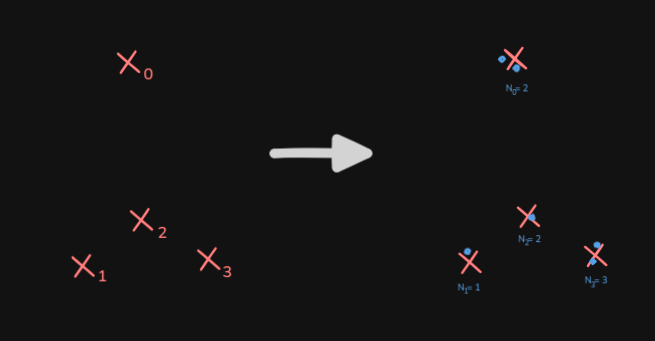
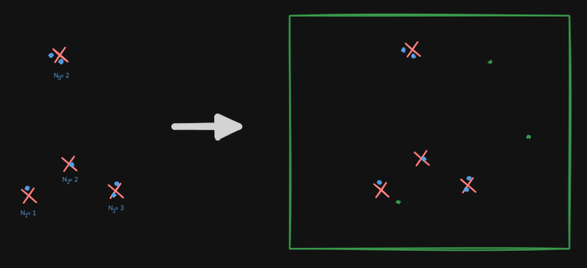
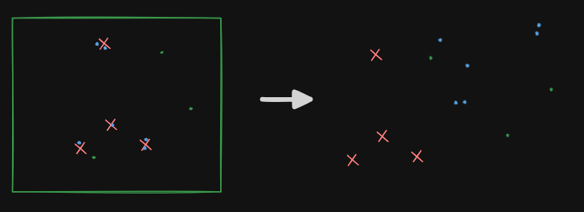

<h1 align="center">Efficient Point Cloud Alignement
</h1>

  
  

## Installation

## Theory

### Problem Statement

Given an original point cloud $\mathcal{P} = \{p_1, p_2, \ldots, p_n\} \subset \mathbb{R}^3$, we observe a corrupted version through the following stochastic process:

1. **Statistical Sampling**: For each point $p_i \in \mathcal{P}$, we sample $N_i$ points from a Gaussian distribution centered at $p_i$, where $N_i \sim \text{Poisson}(\lambda)$. Each sampled point follows $\mathcal{N}(p_i, \sigma^2 I)$.
  - 

2. **Uniform Noise Addition**: We add $U$ uniformly distributed noise points within a bounding box $\mathcal{B} \subset \mathbb{R}^3$, where $U$ follows some random distribution.
  - 

3. **Rigid Transformation**: The entire corrupted point cloud is transformed by an unknown rotation matrix $R \in SO(3)$ and translation vector $t \in \mathbb{R}^3$.
  - 

The observed point cloud is formally:
$$\mathcal{Q} = \{R(q_j) + t : q_j \in \mathcal{S} \cup \mathcal{N}\}$$

where $\mathcal{S} = \bigcup_{i=1}^{n} \{s_{i,k} : k = 1, \ldots, N_i, s_{i,k} \sim \mathcal{N}(p_i, \sigma^2 I)\}$ and $\mathcal{N}$ represents the uniform noise points.

**Objective**: Recover the transformation $(R, t)$ and establish correspondence between $\mathcal{P}$ and the relevant points in $\mathcal{Q}$.

### Additional Hypotheses

#### Hypothesis 1: Exterior Uniform Noise
Uniform noise points are sampled exclusively outside the convex hull of the original point cloud $\mathcal{P}$.

#### Hypothesis 2: Bounded Isotropic Gaussian Noise (points identify their own distribution)
All Gaussian distributions are isotropic, with standard deviation $\sigma \leq \alpha \cdot d_{\min}$, where $d_{\min}$ is the minimum pairwise distance between points in $\mathcal{P}$.

#### Hypothesis 3: Limited Point Separation (the point cloud is not too sparse)
The minimum distance between any two points in $\mathcal{P}$ is at most $\Delta$.

### Problem Variants

#### Variant 1: Minimal Sampling (Simplest Case)
- **Constraints**: $N_i = 1$ for all $i$, and $U = 0$ (no uniform noise)
- **Formulation**: Direct point-to-point correspondence problem
- **Complexity**: Standard rigid registration with Gaussian observation noise

#### Variant 2: Aggregated Sampling with Bounded Noise
- **Constraints**: Known minimum distance $d_{\min}$ between points in $\mathcal{P}$
- **Approach**: Points can be aggregated when their distance $< d_{\min}$, reducing to one representative per cluster
- **Additional**: Allow bounded uniform noise $U \leq U_{\max}$
- **Complexity**: Clustering-based registration with outlier rejection

#### Variant 3: General Case
- **Constraints**: Arbitrary $N_i$ distributions and unbounded uniform noise
- **Complexity**: Full statistical inference problem requiring probabilistic alignment methods

Each variant represents increasing complexity in both the observation model and the required algorithmic sophistication for robust point cloud alignment.
