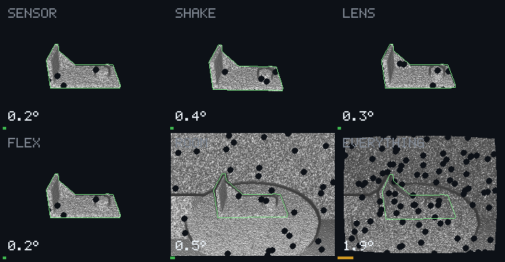

# Step: what answers a frame

The current step of demo B and of the scenes, which now run one pipeline, the
`Follower` of `congru-track`. Same noisy box as [before](hold-step.md), the only
input from the truth. The rules: [what answers](../ideas/method/what-answers.md).

## Demo B, frames within 2° of 90

Before is 0.1.23; the two last paths were never used to choose anything.

| Condition | 0.75 turns, chosen on | 0.55 turns, apart | 1.3 turns, apart | Median, first path |
| --- | --- | --- | --- | --- |
| Room | 81 → **90** | 77 → **83** | 82 → **83** | 0.99° → 0.72° |
| All in a room | 68 → **75** | 71 → **82** | 54 → **60** | 1.43° → 1.24° |
| All effects | 79 → **85** | 81 → **82** | 69 → **81** | 0.72° → 0.44° |
| Shake | 88 → **90** | 88 → **90** | 88 → **90** | 0.58° → 0.21° |
| Sensor, lens, flex | 90 → 90 | 90 → 90 | 90 → 90 | |

All in a room takes about 40 s instead of 130 s over 90 frames, four threads.

## Other sensor seeds

`CONGRU_SEED` moves the sensor's and the box's draws. Seeds 0, then 1, 2, 3:

| Condition | 0.75 turns | 1.3 turns |
| --- | --- | --- |
| All in a room | 75, 78, 73, 78 | 60, 63, 65, 63 |
| All in a room, no box at all | 74, 71, 69 | 65, 65 at seeds 1, 2 |
| All effects | 85, 81, 82, 83 | not measured |

## What each change bought

On the first path. All effects and shake do not run the rays.

| Change | All in a room | Room | All effects | Shake |
| --- | --- | --- | --- | --- |
| 0.1.23 | 68 | 81 | 79 | 88 |
| The place corrected faster than the turn | 74 | 81 | 82 | 88 |
| The answer is what the frame says, not the tracker's filter | 74 | 81 | 87 | 90 |
| A short alignment after the rays | 79 | 86 | 87 | 90 |
| One pipeline, its sampling a share of the size | 78 | 90 | 87 | 90 |
| Back to one bar for a search, 0.3 | 75 | 90 | 85 | 90 |

**The last line loses frames on purpose.** A lower bar, 0.1, answers the first
frames, and on one seed of four started 154° off and stayed lost for 42 frames:
44 of 90. With 0.3, the worst of four seeds is 73.

The tracker no longer runs behind the rays: the same answers, a quarter of the
time.

## The scenes

[Their films](scene-films.md), and [the table](benchmark/scenes.md). From a median
around 1.4 % of the size to around 0.7 %.

## [caution] What fails

- **All effects at 0.55 turns still under its 89 before the hold**: 82, the frames
  after each knock.
- **A knock in a room costs up to ten frames**: at 1.3 turns, the search finds a
  flat wrong pose that confirms 0.84, and is believed until frame 70.
- **The first frames**: nothing is answered while the can hides the part, four
  frames here, a third of a run for the nearest car (48 of 72).
- **Gains are fragile**: on the turn, 0.7 and 0.3 fell to 11 of 90 at 1.3 turns.
- **Thresholds came from one path**, and a small change of sampling moved the room
  from 86 to 90: a few frames are not a result.

