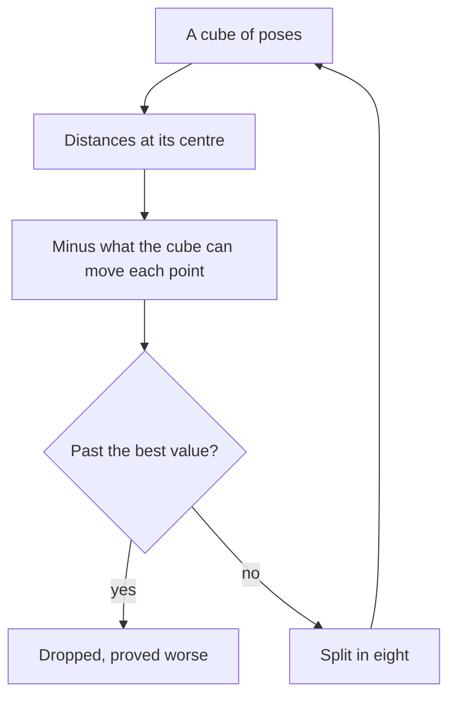

# How the bound is proved

**A search returns a pose; this returns how far any pose can be below it.** The
numbers are in [certified.md](certified.md), the argument in
[the idea](../../ideas/method/certificate.md).

## The steps

- **Upper bound**: the value of a pose actually evaluated. Each batch of cubes
  polishes from its lowest centres, as this bound sets the size of the search.
- **Lower bound**: the least bound of what remains open. A cube's sum stops once
  past the best value: every term is positive, so it is still a bound.
- **The domain**: rotation vectors of norm at most a half turn, where every
  rotation has one. A cube wholly past it is never measured.
- **The proof is the comparison**: when no cube remains, the gap is what was asked.
- **The survivors**: cubes kept at the finest size, the poses not excluded.

## How it was attacked

`cargo test -p congru certificate` runs each of these.

| Attack | What must hold |
| --- | --- |
| 20 000 poses drawn over the whole domain | None under the lower bound |
| 300 poses drawn inside each of 12 cubes, from small to all rotations | None under the cube's bound |
| Noiseless marks, known truth | The truth is among the survivors |
| A quarter turn of a four-fold shape | That turn is among the survivors too |
| A wrong pose given as a seed | Its gap is measured as large |
| Six marks, then sixty | Six keep far poses, sixty exclude them |
| 3 000 cubes, summed in full and stopped | A stopped sum never drops a cube the full sum keeps |
| Half turns on the edge of the domain | Each is among the survivors |
| 20 000 poses drawn just under a half turn | None under the lower bound |
| 3 strays in 15 marks, 20 000 poses drawn | It closes; none under the lower bound; the upper bound is its pose's value |

## How much to trust each claim

| Claim | Trust | Evidence |
| --- | --- | --- |
| The radius of a cube | **[to check]** From the literature | [Go-ICP](https://arxiv.org/abs/1605.03344); the drawn poses test it |
| No pose under the bound | Tested | The first two attacks |
| Gaps on the published instances | Measured | `just bench-certified` |
| Useful to practitioners | **Inferred** | Nobody was asked |

## The limits

- **Floating point**: the bound is widened by a small slack, not proved in exact
  arithmetic.
- **The target**: `run` proves on samples, `run_on_mesh` on the surface itself,
  at a higher cost per query.
- **A box of translations**: nothing is claimed outside it.
- **Scale**: tens of points and seconds of search; past its budget the bound holds
  but stays open, and says so.
- **Peer review**: none. The attacks test the argument, they do not replace it.
- **Simulated instances**: drawn from a seed, not from a survey of real problems.
