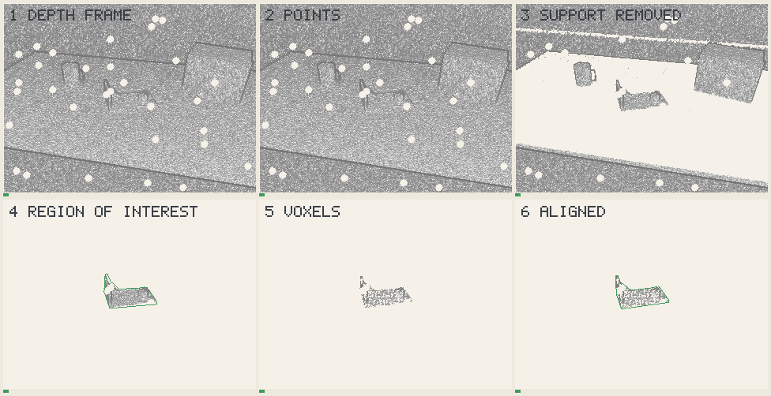
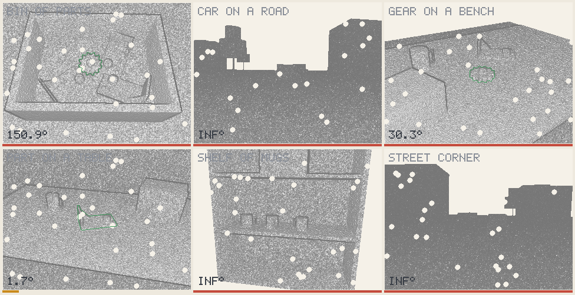
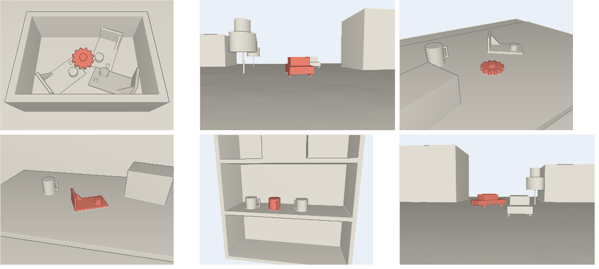

# Scenes

## Realistic scenes

*How one frame is processed: depth, the 2D detector's box (simulated),
the model found by shape, region, voxels, model tracked
([the pipeline](../pipeline.md)).*

Ordinary scenes written as short TOML files in
[scenes/](../../scenes/), rendered by a simulated depth camera; the
target is tinted. Adding one is writing one file.

*Each scene filmed by a wandering camera while its target moves; the green
outline is where the target is found, the number its rotation error.*

**Four scenes of six hold**, none used to choose anything. They run the pipeline
of [demo B](../hold-step.md): a noisy box in place of a detector, poses along
rays, the trajectory held when a frame says nothing.

| Scene | Within 2 % of its size | Median | Within 2° | Why |
| --- | --- | --- | --- | --- |
| Bin of parts | **72 / 72** | 1.18 % | 0 / 72 | A gear: right up to some teeth |
| Part on a table | **71 / 72** | 1.10 % | 71 / 72 | No symmetry: both agree |
| Gear on a bench | **65 / 72** | 1.29 % | 0 / 72 | A gear: right up to one tooth |
| Shelf of mugs | **43 / 72** | 1.88 % | 4 / 72 | The handle hides: a turn is ambiguous |
| Car on a road | 0 / 72 | not found | 0 / 72 | 1 m of noise at 14 m |
| Street corner | 0 / 72 | 406 % | 0 / 72 | 2.6 m of noise at 23 m |

**[caution]**

- **The first column is [ADD-S]**, the distance to the true surface, blind to
  what a symmetry leaves unchanged. A rotation error fails a gear turned by one
  tooth, so both are shown; only the part on a table has a rotation that means
  something.
- **The box comes from the truth**, until a real detector runs.
- **The cars are not an algorithm's failure**: the simulated sensor's noise grows
  as the square of the depth, and exceeds the car's height. Even the truth scores
  zero.
- **The breakdown above still shows the previous pipeline.**

[ADD-S]: https://arxiv.org/abs/1711.00199

| Scene, left to right | What it tests |
| --- | --- |
| bin of parts | A gear on top of a jumble of brackets in an open bin, seen from above: the picking problem. |
| car on a road | A car twelve metres ahead on a bumpy road, another behind it, trees and houses along the side. |
| gear on a bench | A gear lying among a bracket, a mug and crates on a workbench: twelve teeth, twelve near-answers. |
| part on a table | A machined bracket on a table, a mug and a crate beside it, a wall behind. |
| shelf of mugs | A row of mugs on a shelf, one of them the target, all alike but for their handles. |
| street corner | A car turning at a corner twenty metres away, half hidden by a parked one: far, sparse, partly seen. |

## Simple situations

Bare point clouds, every situation of the protocol:
[their own page](scenes-simple.md).
