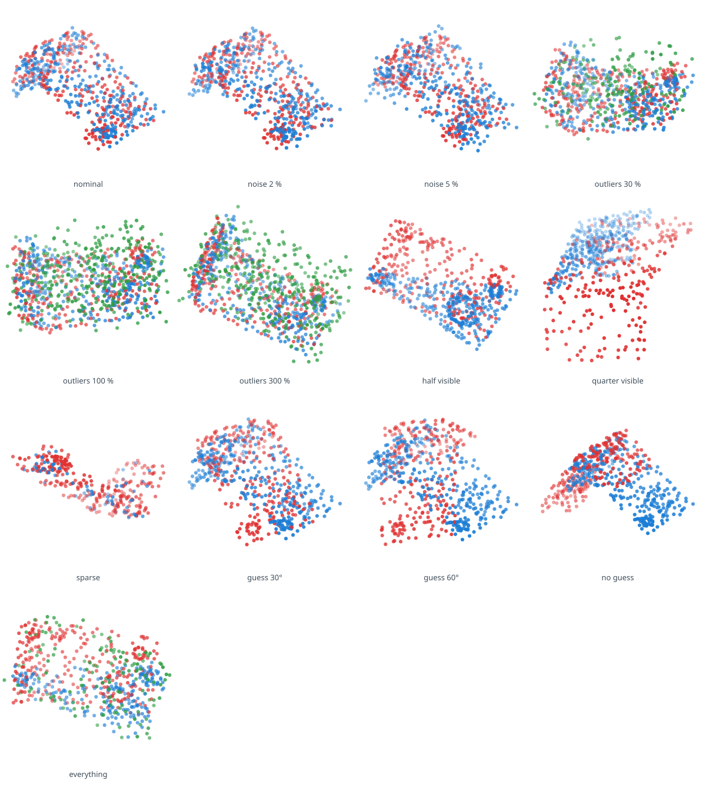
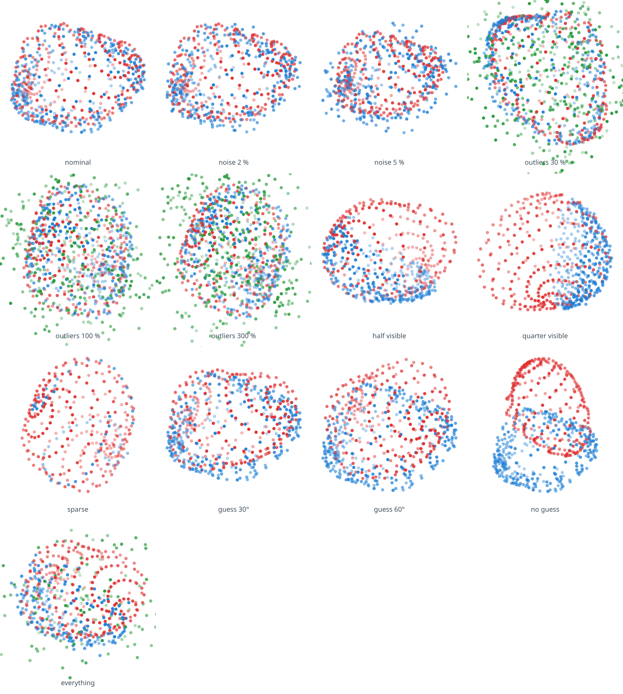
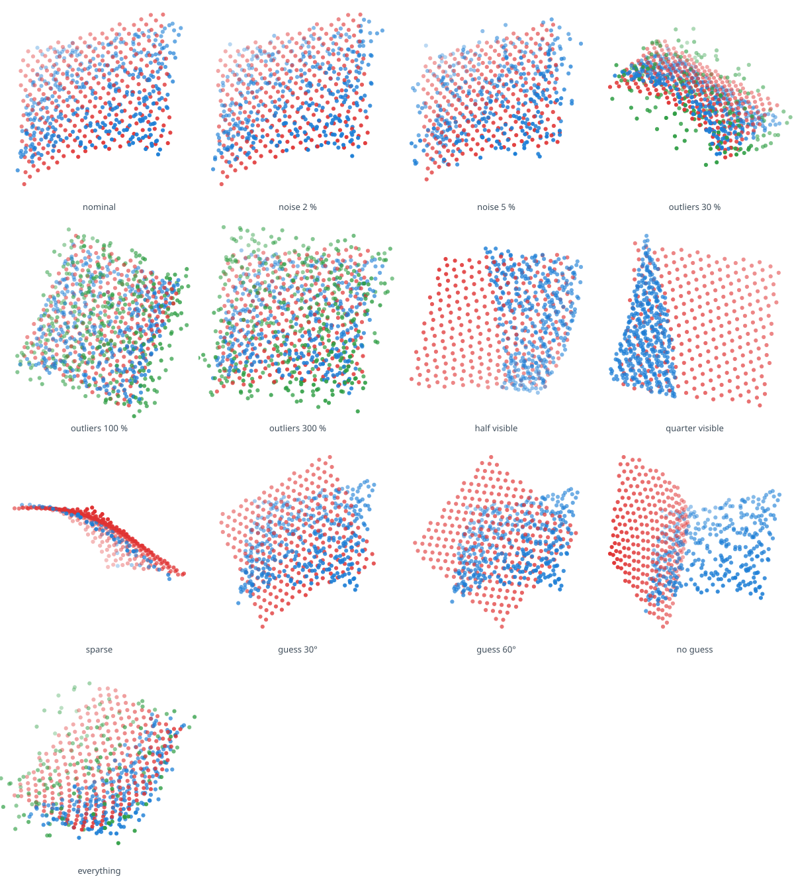
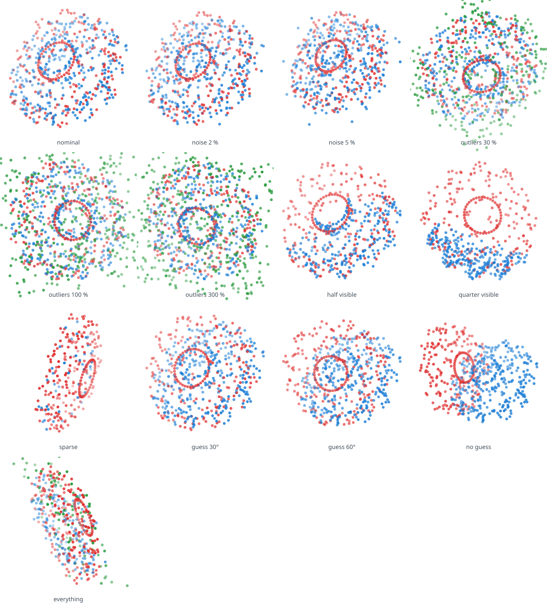

# Scenes

Every situation of the [protocol](protocol.md), drawn exactly as the
methods receive it, for the first evaluation seed: the scan in blue,
its outliers in green, the model at the starting guess in red. A
method must bring the red onto the blue. Written by
`just bench-scenes`.

## bracket

machined part: flat faces, thin plates, a boss and a pin.

## blob

smooth closed surface, nearly round: few features to lock on.

## patch

open curved surface, seen from one side, as a depth camera sees.

## gear

twelve teeth: the same after a twelfth of a turn, a trap for every method.

## Sequences

The tracking sequences, as [demo A](../demos.md) shows them on the bracket.
