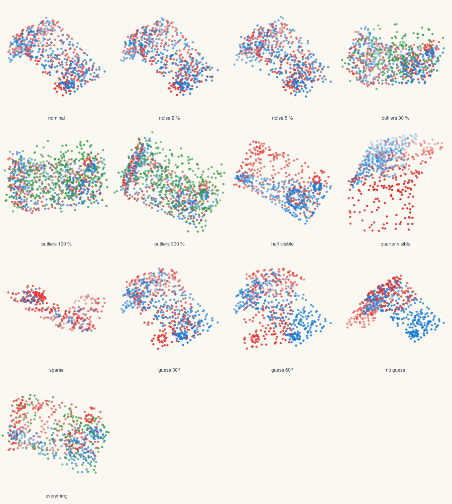
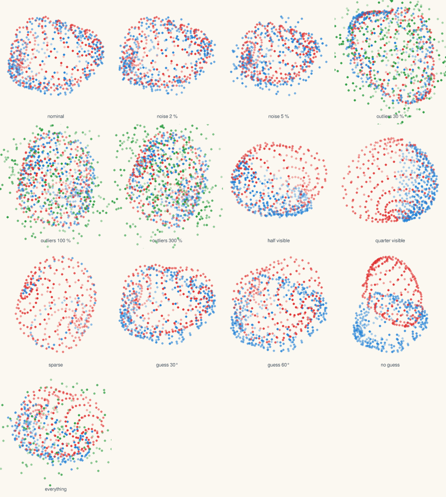
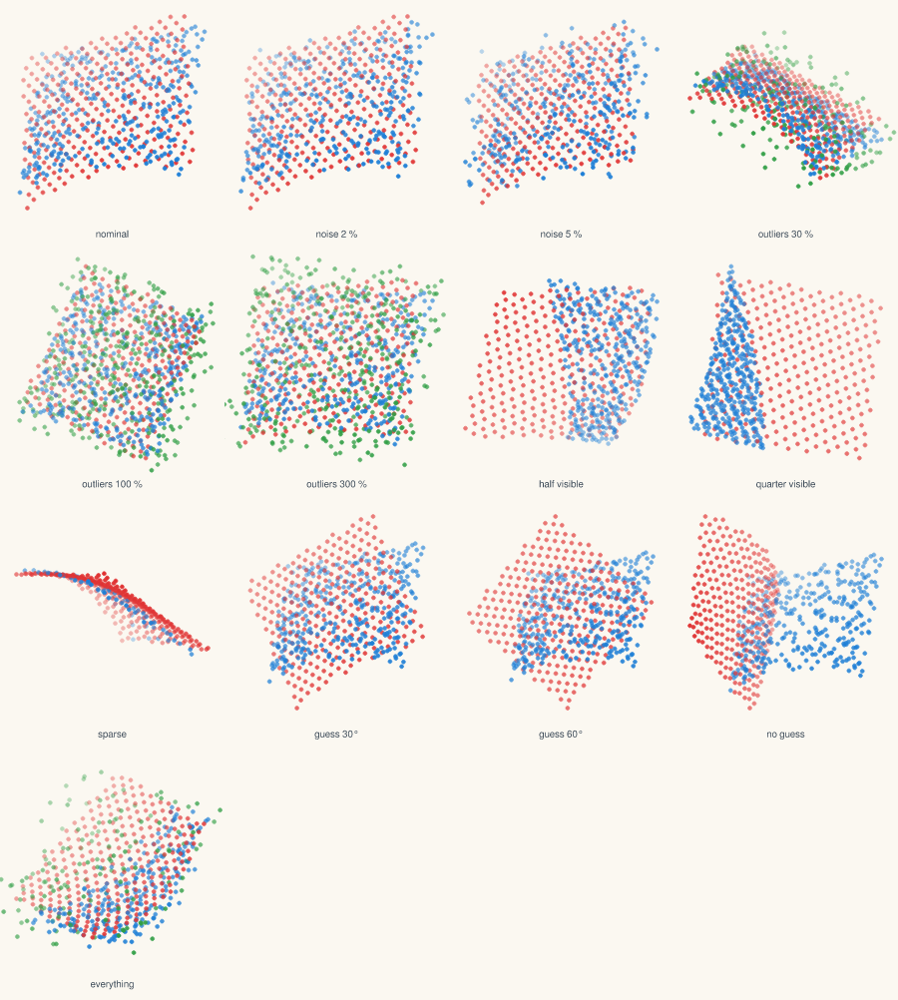
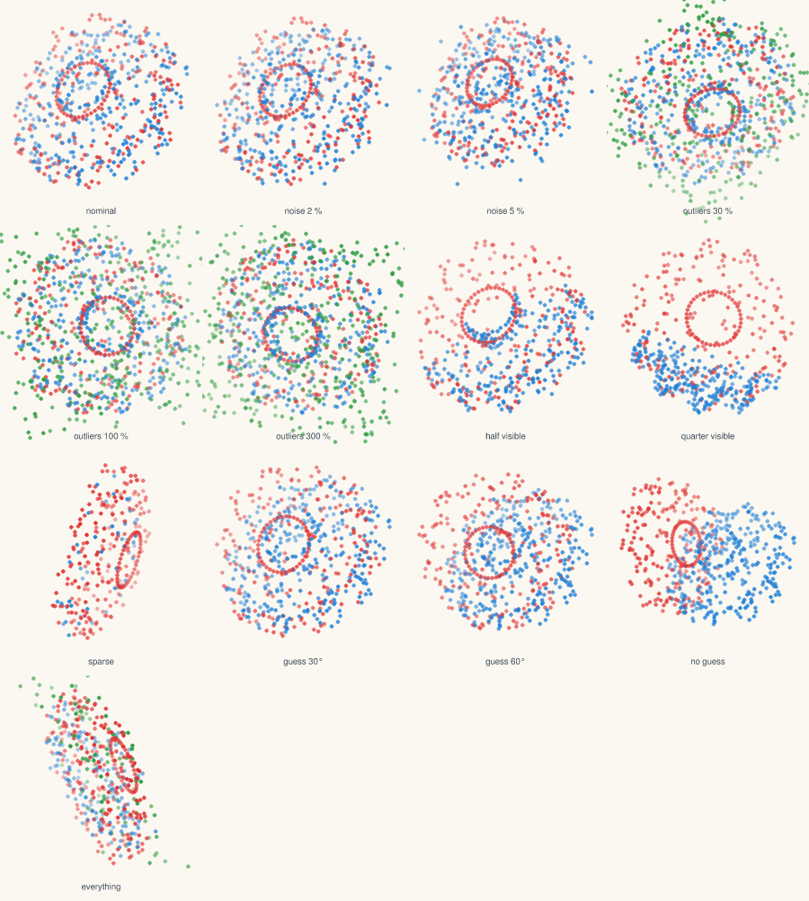

# Scenes

## Realistic scenes

Ordinary scenes written as short TOML files in
[scenes/](../../scenes/), rendered by a simulated depth camera; the
target is tinted. Adding one is writing one file.

*Each scene filmed by a wandering camera while its target moves; the green
outline is where the tracker puts the target, the number its rotation
error. The tracker starts from a detector's guess: it holds the part on
the table on every frame and the gear on two frames in three; on the bin,
the car, the shelf and the street it ends near 150° from a guess 6° off,
which a local method cannot do: a convention to find, the next fix.
`just demo` films them again; each layer is explained in
[the pipeline](../pipeline.md).*

| Scene, left to right | What it tests |
| --- | --- |
| bin of parts | A gear on top of a jumble of brackets in an open bin, seen from above: the picking problem. |
| car on a road | A car twelve metres ahead on a bumpy road, another behind it, trees and houses along the side. |
| gear on a bench | A gear lying among a bracket, a mug and crates on a workbench: twelve teeth, twelve near-answers. |
| part on a table | A machined bracket on a table, a mug and a crate beside it, a wall behind. |
| shelf of mugs | A row of mugs on a shelf, one of them the target, all alike but for their handles. |
| street corner | A car turning at a corner twenty metres away, half hidden by a parked one: far, sparse, partly seen. |

## Simple situations

Every situation of the [protocol](protocol.md), drawn exactly as the
methods receive it, for the first evaluation seed: the scan in blue,
its outliers in green, the model at the starting guess in red. A
method must bring the red onto the blue. Written by
`just bench-scenes`.

## bracket

machined part: flat faces, thin plates, a boss and a pin.

## blob

smooth closed surface, nearly round: few features to lock on.

## patch

open curved surface, seen from one side, as a depth camera sees.

## gear

twelve teeth: the same after a twelfth of a turn, a trap for every method.

## Sequences

The tracking sequences, as [demo A](../demos.md) shows them on the bracket.
