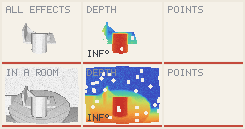
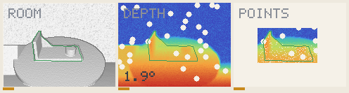
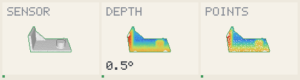
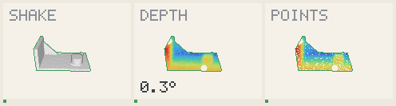
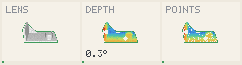
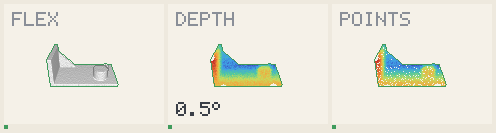

# Step: a noisy box around the part

The current step of demo B. The room alone holds; **the room with every other
effect does not yet**.

The scan is **what a box holds**, points of the turntable and of the wall
included: the model never cuts it to its shape, unlike
[the step before](shape-crop-step.md).

## What the box is

- **The one input taken from the truth**, standing in for a detector until a real
  one runs: the true silhouette's rectangle, 20 % larger, offset by up to 5 % at
  random on each frame.
- **It is used in crowded frames and for detection.** In a frame that holds little
  else than the part, the scan stays a ball around it, as before.

## Frames within 2°

| Condition | 0.75 turns, chosen on | 0.55 turns, apart | 1.3 turns, apart |
| --- | --- | --- | --- |
| Room | 71 / 90 | 77 / 90 | 69 / 90 |
| All in a room | 41 / 90 | **20 / 90** | **13 / 90** |
| All effects | 79 / 90 | not measured | not measured |
| Sensor | 90 / 90 | not measured | not measured |
| Shake | 90 / 90 | not measured | not measured |
| Lens | 90 / 90 | not measured | not measured |
| Flex | 90 / 90 | not measured | not measured |

Median error on the path chosen on: room 1.22°, all in a room 2.63°, all effects
0.74°. Before any of this work, the room and all in a room stood at 0 / 90.

## What each change bought, on the room

| Tracking in a crowded frame | Frames within 2° |
| --- | --- |
| [ICP] from the scan in the box to the model | 1 / 90 |
| Pose along rays only | 32 / 90 |
| Then polished on what the rays say | 66 / 90 |
| Then settled on the returns at the model's depth | 71 / 90 |

## [caution] What fails

- **All in a room**: after each knock of 70°, and while the can crosses, the pose
  is lost for frames, and detection in the box does not always find it again.
- **Every threshold was chosen on the first path**, and the two others show how
  much that flatters it for all in a room.
- **All effects lost frames**: 84 before this work, 79 now. A pose is refuted when
  the rays through it outweigh what it explains, and a right pose sometimes is.
- **The tracker still runs behind the rays** in a crowded frame, only for its
  report; its pose is replaced. That is a patch, not a design.

## All effects, and all in a room

## The room alone

## One effect at a time

[ICP]: https://en.wikipedia.org/wiki/Iterative_closest_point
