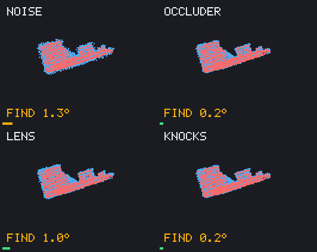
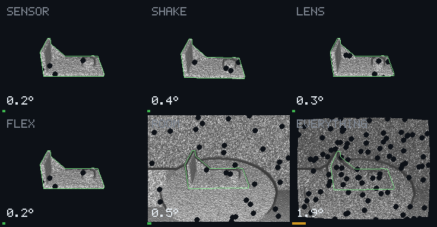

# Demos

Both animations are computed from real runs, frame by frame; `just demo`
writes them again and prints the tables below.

## A — point clouds over time

A machined bracket moves in front of a sensor, in six generated sequences
of 120 frames. The red particles are what the sensor returns; the cyan
points are the model, placed at the pose congru finds, frame after frame.
Each tile says which phase ran (follow from the last pose, or find again
from nothing) and the rotation error against the truth; the bar below
turns amber past 1° and red past 5°.

Every sequence is already hard: a few hundred points per frame, 5 mm of
noise on a 20 cm part, and 40 points of clutter. Each adds one trouble:

| Run | Added | Median error | Frames within 2° |
| --- | --- | --- | --- |
| Noise | nothing | 0.91° | 114 / 120 |
| Shake | the sensor jolts every frame, 0.6° and 4 mm | 1.00° | 111 / 120 |
| Bend | the part flexes by up to 4 mm | 1.07° | 112 / 120 |
| Occluder | a ball crosses in front | 0.94° | 112 / 120 |
| Lens | radial distortion | 1.17° | 103 / 120 |
| Knocks | two abrupt turns of 70° and 60° | 0.95° | 113 / 120 |

For scale: aligning one such frame alone, from the true pose, already
leaves about 0.85° of error. What tracking adds is holding on: through the
ball, the jolts and the knocks, the pose never drifts away.

How it works: the follow phase aligns each frame onto the side of the model
facing the sensor, pulled toward the predicted pose, with a robust kernel
scaled by the noise it has learned; a frame it cannot explain is searched
again at once ([tracking](../ideas/method/tracking.md)).

## B — a simulated depth camera

*Demo B: a simulated robot cell. A machined bracket turns on a turntable under a
depth camera. Each panel is what the camera returns, shaded by its surface
normals; the green outline is the part's model drawn at the pose congru
found; the bar below is the rotation error (green under 1°, amber under 5°).
Top left: exact depth. Top right: noise and blur. Bottom left: holes and
flying pixels. Bottom right: all of it, with the turntable in view.*

| Condition | Median error | Frames within 2° |
| --- | --- | --- |
| Exact depth | 0.05° | 90 / 90 |
| Noise and blur | 0.48° | 86 / 90 |
| Holes and flying pixels | 0.22° | 81 / 90 |
| Everything, and the turntable | 0.71° | 90 / 90 |

Computed offline, frame by frame, by `just demo`; the pipeline (support
plane removed, scan cropped, aligned onto the part of the model visible
from the predicted pose) is real-time by design
([the demo](../ideas/demo/README.md)).
