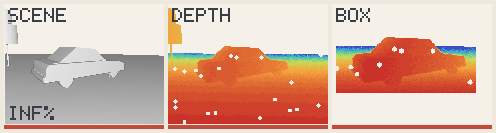
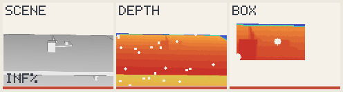
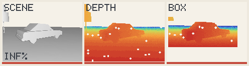
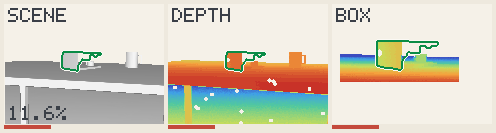
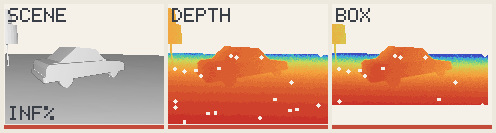
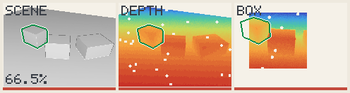
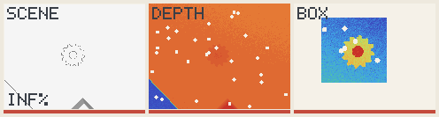
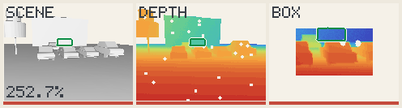

# The failing ones

Every scene under each box, kept here while it fails: written by `just failing`,
which empties this page as they are fixed. All simulated.

- **A failing scene**: under 60 of 72 frames within 2 % of the object's size.
- **The box** stands for a detector: its shift and its growth are shares of the
  object's size. [Why it matters](../ideas/method/box-as-test.md).

## Under the usual box, ±5 %, +20 %

Holding: bin of parts, bracket behind a crate, bracket in a bin, bracket at a
low angle, car on a road, crate among crates, gear from above, gear on a bench,
mug close up, parking lot, part on a table, shelf of mugs, street corner, twin
brackets, workshop.

### car close by

0 of 72 within 2 % of its size, median inf %; 0 within 2°; 0 believed and wrong.

## Under a realistic box, ±10 %, +40 %

Holding: bin of parts, bracket in a bin, bracket at a low angle, car on a road,
crate among crates, gear from above, gear on a bench, mug close up, parking lot,
part on a table, shelf of mugs, street corner, twin brackets, workshop.

### bracket behind a crate

54 of 72 within 2 % of its size, median 0.84 %; 52 within 2°; 0 believed and
wrong.

### car close by

36 of 72 within 2 % of its size, median inf %; 34 within 2°; 0 believed and
wrong.

## Under a wide box, ±25 %, +100 %

Holding: bin of parts, bracket behind a crate, bracket in a bin, car on a road,
gear on a bench, mug close up, part on a table, shelf of mugs, street corner,
twin brackets, workshop.

### bracket at a low angle

48 of 72 within 2 % of its size, median 0.97 %; 48 within 2°; 24 believed and
wrong.

### car close by

0 of 72 within 2 % of its size, median inf %; 0 within 2°; 0 believed and wrong.

### crate among crates

0 of 72 within 2 % of its size, median 78.29 %; 0 within 2°; 72 believed and
wrong.

### gear from above

0 of 72 within 2 % of its size, median inf %; 0 within 2°; 0 believed and wrong.

### parking lot

6 of 72 within 2 % of its size, median 271.06 %; 6 within 2°; 66 believed and
wrong.
