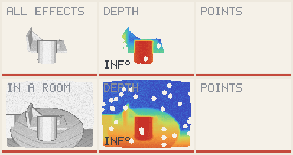
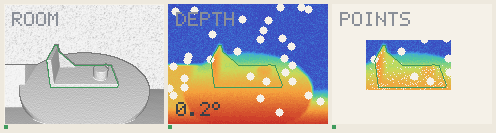
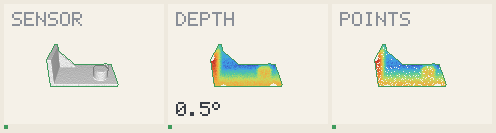
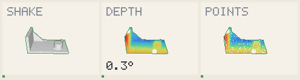
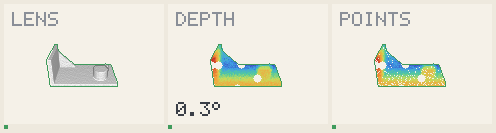
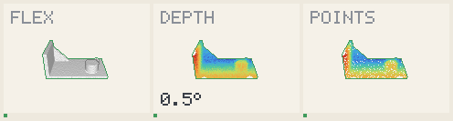

# Step: holding on when a frame says nothing

A step of demo B, [better answered since](answer-step.md). **The room with every
effect now holds on all three paths**, from 0 of 90 at the start of this work.

Same noisy box as [the step before](box-step.md), the only input from the truth.
What is new is deciding, at each frame, whether to believe it.

## Frames within 2°

The first number stood before this work; the two last paths were never used to
choose anything.

| Condition | 0.75 turns, chosen on | 0.55 turns, apart | 1.3 turns, apart |
| --- | --- | --- | --- |
| Room | 0 → **78** | 0 → **73** | 0 → **79** |
| All in a room | 0 → **68** | 0 → **74** | 0 → **57** |
| All effects | 84 → 77 | 89 → 81 | 76 → 69 |
| Shake | 90 → 88 | 90 → 88 | 88 → 87 |
| Sensor | 90 → 90 | 90 → 90 | 87 → 87 |
| Lens | 90 → 90 | 90 → 90 | 87 → 87 |
| Flex | 90 → 90 | 90 → 90 | 87 → 87 |

Median error on the first path: room 0.96°, all in a room 1.48°, all effects 0.75°.

## What decides

The rule is in [holding on](../ideas/method/hold-through-loss.md).

| The frame says | Answer |
| --- | --- |
| It confirms the pose about as well as lately | Believe it, and smooth it |
| Rays stop before the forecast: hidden | Go on along the trajectory |
| Rays go through the forecast: refuted | Search again, every orientation where it stood |

## What each change bought

All in a room, on the path of 1.3 turns, which fell hardest.

| Change | Frames within 2° |
| --- | --- |
| The noisy box alone | 13 / 90 |
| Holding, as first written | 13 / 90 |
| A bug fixed: a detected pose was thrown away | 54 / 90 |
| Every orientation tried at the forecast place | 59 / 90 |

Answering the filter's smoothed pose then costs a little here (57), and brings
the room at 0.55 turns from 67 to 73.

## [caution] What fails

- **All effects recedes by 7 or 8 frames**, and shake by 1 or 2. A right pose is
  sometimes not believed, and a forecast answers instead.
- **The first frames in a room**: the can hides the part, the detector answers
  nothing for three or four frames. A right pose there confirms 0.11, a wrong one
  0.18 elsewhere: no threshold tells them apart.
- **The realistic scenes are not on this pipeline yet**: still 0 of 72.
- **The forecast is one model**: constant velocity. It depends on the object.
- **Thresholds came from one path**: half the recent level, 15 % of rays through.

## All effects, and all in a room

## The room alone

## One effect at a time

