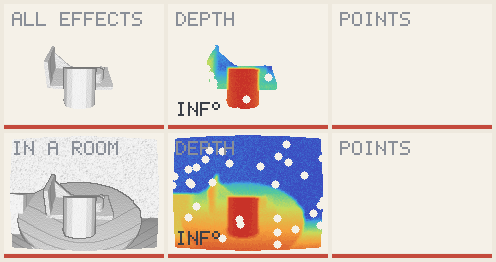
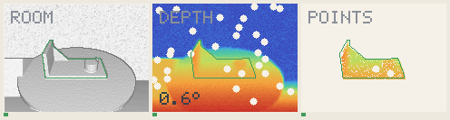
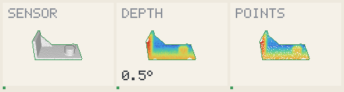
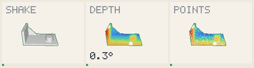
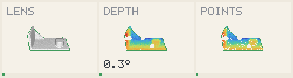
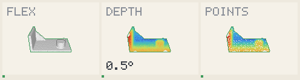

# Step: the scan cut to the model's shape

An intermediate step of demo B, kept as it was at commit `c9609d8`. It shows the
case a model can be aligned in: **every point given to the tracker lies on the
object**. Nothing reached it before.

**[caution]** This step is not a result on a real sensor:

- **The scan is cut with the model's own silhouette**, at the predicted pose. A
  hypothesis chooses the data that confirm it, so the "points" panels look perfect.
- **The truth is not used by that cut**, and the errors shown are real ones.
- **The next step** gives a noisy box instead, with points that are not on the
  object inside it.

| Condition | Median error | Frames within 2° |
| --- | --- | --- |
| All effects | 0.72° | 83 / 90 |
| All in a room | 1.04° | 76 / 90 |
| Sensor | 0.19° | 90 / 90 |
| Shake | 0.57° | 90 / 90 |
| Lens | 0.29° | 90 / 90 |
| Flex | 0.26° | 90 / 90 |
| Room | 0.51° | 90 / 90 |

## All effects, and all in a room

## The room alone

## One effect at a time

