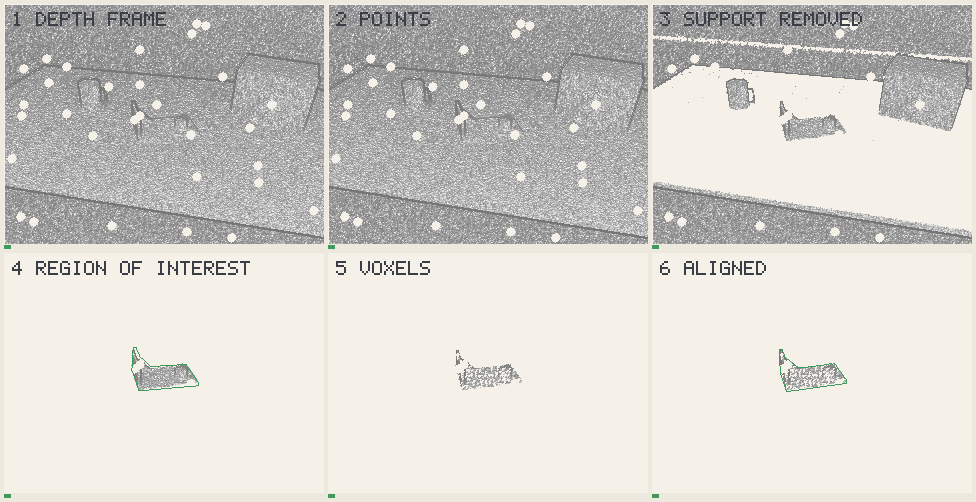

# The pipeline, layer by layer



What the camera gives, and what the method makes of it, on the first
frame. One input is still simulated from the truth: the 2D box a colour
detector would draw (step 2). Everything after it uses the depth only.

1. **Depth frame.** One depth image, as a depth camera or a headset's
   lidar returns it: noise growing with distance, holes, flying pixels on
   edges. Light means near.
2. **Detector box.** The pixels inside the box a 2D detector on the colour
   image would return (a [YOLO]-like network on a headset). Simulated here:
   the true silhouette's box, 40 % wider and shifted by a tenth. It gives
   no depth and no orientation.
3. **Found by shape.** The box's pixels become 3D points; the model is
   searched among them by [point pair features] voted, each candidate
   rendered and checked against the depth, inside its silhouette and just
   outside it. No guess, no plane. The green outline is the best
   candidate; a wrong one shows here, and none past the threshold means
   *not found*.
4. **Region kept.** Only the points within a little more than half the
   model's size of that place: the scene around is no longer seen.
5. **Voxels.** One point per cube a sixtieth of the model's size, so a
   near object no longer weighs more than a far one.
6. **Tracked.** The model aligned onto those voxels by the tracker
   ([ICP], point-to-plane, robust kernel): the green outline is its pose.
   Later frames start from here, not from the detector.

`CONGRU_SCENE="gear on a bench" just demo` draws it for another scene.

What happens between a camera frame and a pose, in the demos and the
realistic scenes. Each layer is its own function; the table says where it
lives and what is still missing.

```text
 depth frame ─► 2D box ─► found ─► region ─► thinned ─► tracker ─► pose
 (depth only)   (colour   by shape  around    voxel     predict,    + trust
                detector, (first    the last  grid      follow,     + free
                simulated) frame,   pose                find        motions
                           or lost)
```

| Layer | What it does | Where | Today |
| --- | --- | --- | --- |
| **1. Frame** | A depth image: the distance along the optical axis at every pixel. The colour image is not used | [congru-vision](../crates/congru-vision/src/lib.rs) | Simulated: scenes rendered by rasterising meshes, then degraded (noise growing with depth, holes, flying pixels, a hand-held camera) by [congru-sim](../crates/congru-sim/src/lib.rs) |
| **2. Points** | Every valid pixel back-projected through the pinhole camera into a 3D point | `back_project` | Done |
| **3. Found by shape** | On the first frame, or once the tracker has let go: the model searched by point pair features in the detector's box, checked against the depth | [`Finder`](../crates/congru-vision/src/perception/find/mod.rs) | Done. **The 2D box is simulated from the truth**: milestone 2 replaces it by a real detector |
| **4. Region** | Only the points within 0.6 of the model's size around the last pose | `within` | Done |
| **5. Thinned** | One point per voxel, a sixtieth of the target's size: a density independent of distance | `PointCloud::voxel_downsample` | Done |
| **6. Tracker** | Predict the pose from the last ones (alpha-beta filter); align the region onto the side of the model the camera would see there (point-to-plane ICP, Tukey kernel scaled by the learned noise, pulled toward the prediction); if the frame fails its health check, search all rotations | [congru-track](../crates/congru-track/src/lib.rs) | Done; see [tracking](../ideas/method/tracking.md) |
| **7. Answer** | The pose, whether it is trusted, which motions the frame left free | `Update`, `Observability` | Done |

[YOLO]: https://arxiv.org/abs/1506.02640
[point pair features]: https://doi.org/10.1109/CVPR.2010.5540108
[ICP]: https://en.wikipedia.org/wiki/Iterative_closest_point

## Which demo uses which layers

| Animation | Starts at | Why |
| --- | --- | --- |
| Demo A, point clouds | Layer 5 | Synthetic point clouds, no camera: the alignment alone |
| Demo B, the turntable | Layer 1 | One part, a known room, a crop from the prediction |
| Realistic scenes | Layer 1 | Ordinary scenes, the same layers, a detector's first guess |

## What milestone 2 adds

- **A real detector** at layer 4: a segmentation network or, without one,
  clustering (DBSCAN) of what is left after layer 3: the *mostly the
  object* rung of the [ladder](../ideas/problem/hypothesis-ladder.md).
- **Colour** at layer 1, to tell apart objects of the same shape.
- **Real recordings**, RGB-D and lidar, in place of the simulated frame.
