# Projection: cases, frame by frame

Still frames of demo B, from real runs, each answering
[what a depth frame says](../ideas/problem/visibility.md). The truth only scores:
the search never sees it.

| Panel | What it shows |
| --- | --- |
| truth | The depth, near in red and far in blue, the true outline over it |
| found | The same, with the outline of the pose the search answers |
| rays, truth | The model at the truth, each pixel judged by its ray |
| rays, found | The same at the pose found |

Rays: green on the surface, amber hidden, red when the ray went through the model.
White spots in the depth are holes. The bar below each panel is the rotation error.

The reading compares scores: a wrong pose under the truth's score means the search
never offered the truth; above it, the score itself fails. Written by
`congru-demo cases`.

## sensor, frame 0

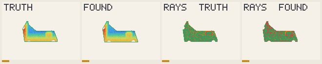

- **Off by**: 1.7° and 3 mm.
- **Score**: truth 16.7, found 17.9.
- **Reading**: right.

## sensor, frame 51

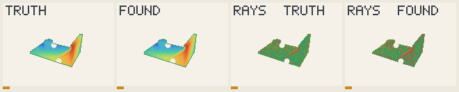

- **Off by**: 1.4° and 1 mm.
- **Score**: truth 13.2, found 12.4.
- **Reading**: right.

## shake, frame 40

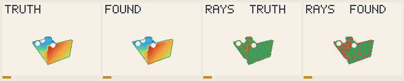

- **Off by**: 1.7° and 3 mm.
- **Score**: truth 12.1, found 10.5.
- **Reading**: right.

## lens, frame 27

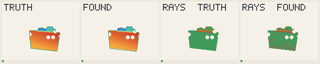

- **Off by**: 0.4° and 4 mm.
- **Score**: truth 8.3, found 7.1.
- **Reading**: right.

## flex, frame 30

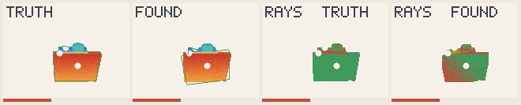

- **Off by**: 11.1° and 10 mm.
- **Score**: truth 5.9, found 2.8.
- **Reading**: wrong, and the score knows: the search never offered the truth.

## all effects, frame 0

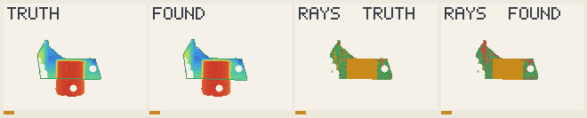

- **Off by**: 1.4° and 3 mm.
- **Score**: truth 5.9, found 5.5.
- **Reading**: right.

## all effects, frame 27

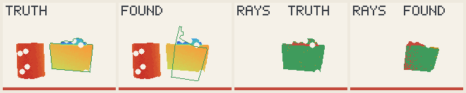

- **Off by**: 3.5° and 7 mm.
- **Score**: truth 3.3, found 5.7.
- **Reading**: right.

## room, frame 0

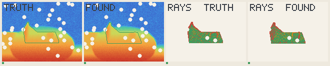

- **Off by**: 1.2° and 3 mm.
- **Score**: truth 13.8, found 11.8.
- **Reading**: right.

## room, frame 7

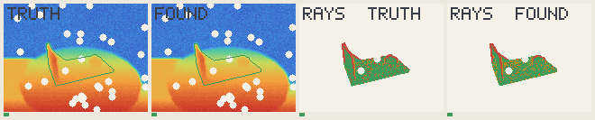

- **Off by**: 0.7° and 2 mm.
- **Score**: truth 15.3, found 14.7.
- **Reading**: right.

## room, frame 27

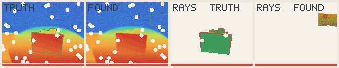

- **Off by**: 135.3° and 363 mm.
- **Score**: truth 5.9, found 2.5.
- **Reading**: wrong, and the score knows: the search never offered the truth.

## room, frame 40

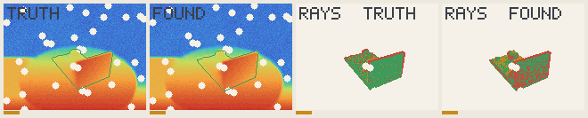

- **Off by**: 2.2° and 7 mm.
- **Score**: truth 10.2, found 5.5.
- **Reading**: right.

## in a room, frame 0

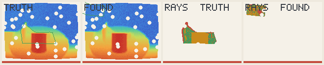

- **Off by**: 60.4° and 486 mm.
- **Score**: truth 3.5, found -2.1.
- **Reading**: wrong, and the score knows: the search never offered the truth.

## in a room, frame 7

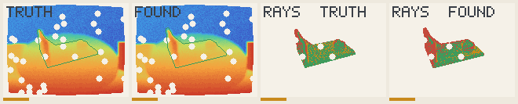

- **Off by**: 4.1° and 4 mm.
- **Score**: truth 12.3, found 7.5.
- **Reading**: right.

## in a room, frame 27

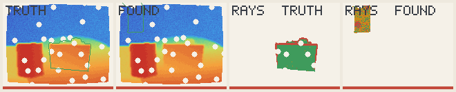

- **Off by**: 165.2° and 407 mm.
- **Score**: truth -0.5, found 2.3.
- **Reading**: wrong, and the score prefers it: the score itself fails.

## in a room, frame 40

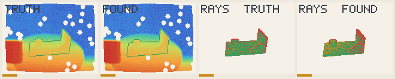

- **Off by**: 3.1° and 2 mm.
- **Score**: truth 18.3, found 14.2.
- **Reading**: right.

## in a room, frame 73

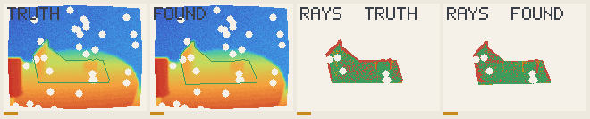

- **Off by**: 1.9° and 4 mm.
- **Score**: truth 11.8, found 13.8.
- **Reading**: right.
