# Scene films

Every scene, as demo B draws it. Written by `just demo`, from real runs.

- **Left**: the scene. **Middle**: the depth. **Right**: the points the box holds.
- **Green outline**: the model at the pose found, the same on all three.
- **The number**: how far off, as a share of the object's size; the bar turns amber
  past 2 %, red past 10 %.
- **The box comes from the truth**, a little larger, a little off, until a real
  detector runs. Nothing else does.

## bin of parts

A gear on top of a jumble of brackets in an open bin, seen from above: the
picking problem.

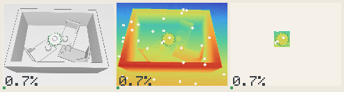

72 of 72 within 2 % of its size, median 0.80 %; 0 within 2°.

## bracket behind a crate

A small crate hides one end of a bracket: part of what would pin the pose is out
of sight.

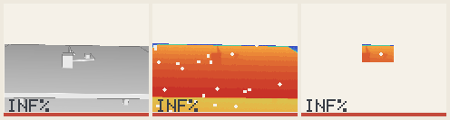

66 of 72 within 2 % of its size, median 0.76 %; 64 within 2°.

## bracket in a bin

An asymmetric bracket tilted among gears in a bin: picking, with a pose that
means something.

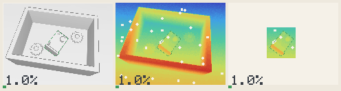

72 of 72 within 2 % of its size, median 0.59 %; 71 within 2°.

## bracket at a low angle

The camera nearly at table height: grazing rays, the plate seen edge on.

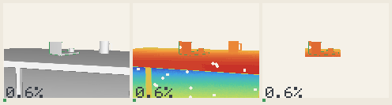

72 of 72 within 2 % of its size, median 0.75 %; 69 within 2°.

## car close by

A car six metres away under the same depth camera: its noise is now a part of
its size, not all of it.

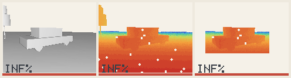

60 of 72 within 2 % of its size, median 0.58 %; 60 within 2°.

## car on a road

A car twelve metres ahead on a bumpy road, another behind it, trees and houses
along the side.

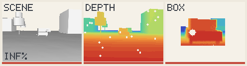

54 of 72 within 2 % of its size, median 0.80 %; 54 within 2°.

## crate among crates

A plain box among other boxes: only flat faces, and a shape that repeats.

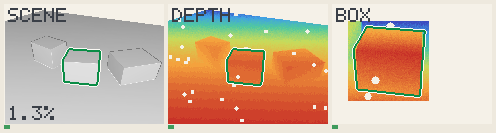

72 of 72 within 2 % of its size, median 0.96 %; 0 within 2°.

## gear from above

A gear lying flat, seen straight down: flat on flat, the view the votes cannot
read.

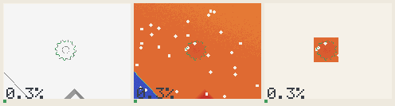

72 of 72 within 2 % of its size, median 0.53 %; 0 within 2°.

## gear on a bench

A gear lying among a bracket, a mug and crates on a workbench: twelve teeth,
twelve near-answers.

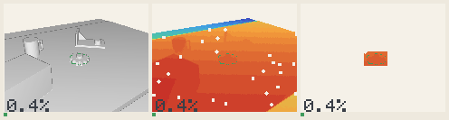

72 of 72 within 2 % of its size, median 0.74 %; 0 within 2°.

## mug close up

A mug filling much of the view, its handle in sight: little clutter, much
noise-free detail.

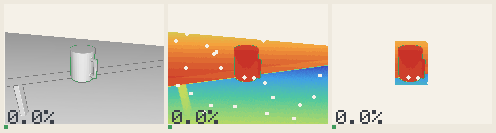

72 of 72 within 2 % of its size, median 0.40 %; 72 within 2°.

## part on a table

A machined bracket on a table, a mug and a crate beside it, a wall behind.

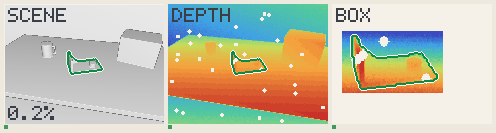

72 of 72 within 2 % of its size, median 0.66 %; 72 within 2°.

## shelf of mugs

A row of mugs on a shelf, one of them the target, all alike but for their
handles.

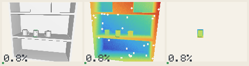

72 of 72 within 2 % of its size, median 1.20 %; 0 within 2°.

## street corner

A car turning at a corner twenty metres away, half hidden by a parked one: far,
sparse, partly seen.

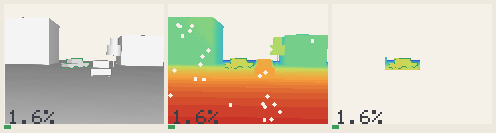

72 of 72 within 2 % of its size, median 1.03 %; 70 within 2°.

## twin brackets

A bracket among three identical ones on a table: only the box tells which.

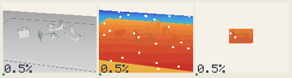

72 of 72 within 2 % of its size, median 0.69 %; 72 within 2°.
