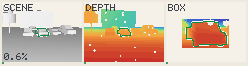
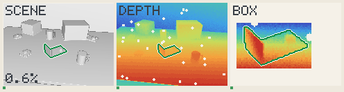

# Scene films

Every scene, as demo B draws it. Written by `just demo`, from real runs.

- **Left**: the scene. **Middle**: the depth. **Right**: what the box holds, enlarged,
  coloured over its own depths.
- **Green outline**: the model at the pose found, the same on all three.
- **The number**: how far off, as a share of the object's size; the bar turns amber
  past 2 %, red past 10 %.
- **Believed and wrong**: frames that gave a pose more than 10 % off, the ones that
  matter most: a robot acts on them.
- **The box comes from the truth**, a little larger, a little off, until a real
  detector runs. Nothing else does.
  [A wider box breaks some scenes](../ideas/method/box-as-test.md).

## bin of parts

A gear on top of a jumble of brackets in an open bin, seen from above: the
picking problem.

72 of 72 within 2 % of its size, median 0.80 %; 0 within 2°; 0 believed and
wrong.

## bracket behind a crate

A small crate hides one end of a bracket: part of what would pin the pose is out
of sight.

66 of 72 within 2 % of its size, median 0.76 %; 63 within 2°; 0 believed and
wrong.

## bracket in a bin

An asymmetric bracket tilted among gears in a bin: picking, with a pose that
means something.

72 of 72 within 2 % of its size, median 0.58 %; 71 within 2°; 0 believed and
wrong.

## bracket at a low angle

The camera nearly at table height: grazing rays, the plate seen edge on.

72 of 72 within 2 % of its size, median 0.72 %; 68 within 2°; 0 believed and
wrong.

## car close by

A car six metres away under the same depth camera: its noise is now a part of
its size, not all of it.

0 of 72 within 2 % of its size, median inf %; 0 within 2°; 0 believed and wrong.

## car on a road

A car twelve metres ahead on a bumpy road, another behind it, trees and houses
along the side.

66 of 72 within 2 % of its size, median 0.77 %; 64 within 2°; 0 believed and
wrong.

## crate among crates

A plain box among other boxes: only flat faces, and a shape that repeats.

72 of 72 within 2 % of its size, median 0.93 %; 0 within 2°; 0 believed and
wrong.

## gear from above

A gear lying flat, seen straight down: flat on flat, the view the votes cannot
read.

72 of 72 within 2 % of its size, median 0.53 %; 0 within 2°; 0 believed and
wrong.

## gear on a bench

A gear lying among a bracket, a mug and crates on a workbench: twelve teeth,
twelve near-answers.

72 of 72 within 2 % of its size, median 0.74 %; 0 within 2°; 0 believed and
wrong.

## mug close up

A mug filling much of the view, its handle in sight: little clutter, much
noise-free detail.

72 of 72 within 2 % of its size, median 0.40 %; 72 within 2°; 0 believed and
wrong.

## parking lot

One car among a row of parked ones, nearly alike, with a van and a tree: only
the box says which.

72 of 72 within 2 % of its size, median 0.84 %; 72 within 2°; 0 believed and
wrong.

## part on a table

A machined bracket on a table, a mug and a crate beside it, a wall behind.

72 of 72 within 2 % of its size, median 0.65 %; 72 within 2°; 0 believed and
wrong.

## shelf of mugs

A row of mugs on a shelf, one of them the target, all alike but for their
handles.

71 of 72 within 2 % of its size, median 1.18 %; 0 within 2°; 0 believed and
wrong.

## street corner

A car turning at a corner twenty metres away, half hidden by a parked one: far,
sparse, partly seen.

72 of 72 within 2 % of its size, median 0.97 %; 66 within 2°; 0 believed and
wrong.

## twin brackets

A bracket among three identical ones on a table: only the box tells which.

72 of 72 within 2 % of its size, median 0.69 %; 72 within 2°; 0 believed and
wrong.

## workshop

A bracket on a crowded bench, among gears, mugs, crates and a twin further back,
a wall behind.

72 of 72 within 2 % of its size, median 0.74 %; 72 within 2°; 0 believed and
wrong.
