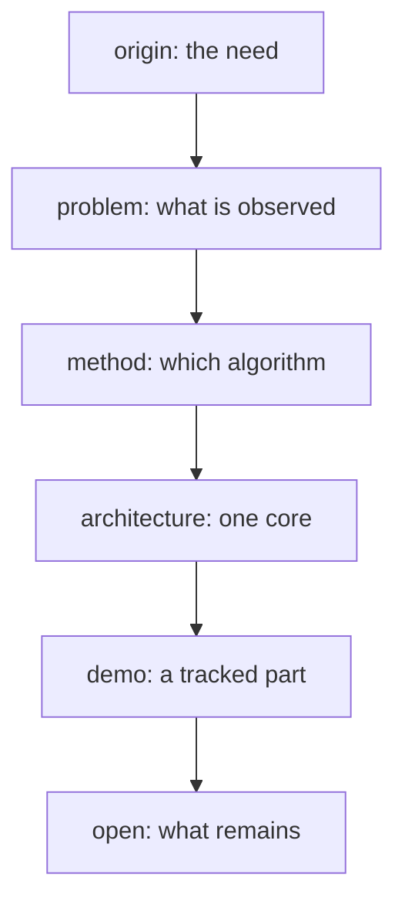

# ideas/ — map

The core of the project: **one concept per file**, short, informal first.
Code, README and paper are written from here; a choice that is not here yet
is not made yet.

Tags: **[defined]** (fixed by the author), **[sketch]** (argued, unchecked),
**[guess]**, **[to check]** (claim about prior art), **[question]** (the
author decides), **[caution]** (known trap).

## Thesis

Aligning two views of the same rigid object is solved in papers, not in
practice: every team rewrites ICP, tunes it on its own data, and cannot
ship it to the robot. The project is:

- **one small, typed, fast registration brick**, written once in Rust;
- called from Python, C++ or firmware;
- **measured against a known truth** under noise, outliers and partial
  views, not hoped for.

## The path

## Files

| Part | Files |
| --- | --- |
| Root | [vision.md](vision.md) · [origin.md](origin.md) · [milestones.md](milestones.md) · [naming.md](naming.md) · [open.md](open.md) · [prior-art.md](prior-art.md) · [beyond.md](beyond.md) |
| Problem | [observation-model](problem/observation-model.md) · [hypotheses](problem/hypotheses.md) · [hypothesis-ladder](problem/hypothesis-ladder.md) · [variants](problem/variants.md) · [what-we-know](problem/what-we-know.md) · [measuring-success](problem/measuring-success.md) · [sequences](problem/sequences.md) · [visibility](problem/visibility.md) · [ladder of clouds](problem/cloud-ladder.md) |
| Method | [closed-form](method/closed-form.md) · [landscape](method/landscape.md) · [icp-family](method/icp-family.md) · [robustness](method/robustness.md) · [global-initialisation](method/global-initialisation.md) · [aggregation](method/aggregation.md) · [mesh-targets](method/mesh-targets.md) · [observability](method/observability.md) · [tracking](method/tracking.md) · [detection](method/detection.md) · [ray-evidence](method/ray-evidence.md) · [pose-information](method/pose-information.md) · [hold-through-loss](method/hold-through-loss.md) · [flat-view-reading](method/flat-view-reading.md) · [what-answers](method/what-answers.md) · [box-as-test](method/box-as-test.md) · [contour-term](method/contour-term.md) |
| Architecture | [layers](architecture/layers.md) · [types](architecture/types.md) · [bindings](architecture/bindings.md) · [embedded](architecture/embedded.md) · [performance](architecture/performance.md) · [acceleration](architecture/acceleration.md) · [benchmark](architecture/benchmark.md) · [stack](architecture/stack.md) · [extension-points](architecture/extension-points.md) · [contract](architecture/contract.md) |
| Demo | [README](demo/README.md): A, point clouds over time; B, a depth camera |
