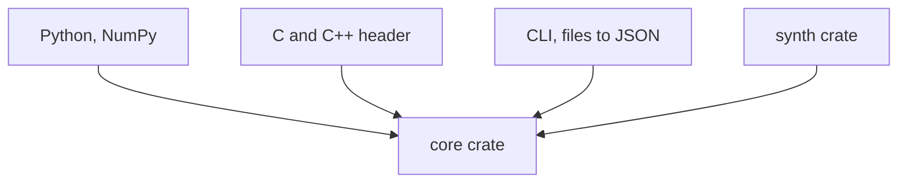

# Layers

**[sketch]** One core, thin skins. Nothing above the core holds an
algorithm.

- **Core**: geometry, search, fit, ICP, global; no I/O, no threads.
- **Synth**: the observation model and its truth, for tests only.
- **Skins**: they only convert, validate and call.
- **[defined]** One exception stands beside the core:
  [the embedded crate](embedded.md), without `std`, holds its own small ICP.

## Rules

- **[sketch]** The core reads no file and prints nothing: a robot has no
  terminal, a headset no file system to spare.
- **[sketch]** A skin never re-implements a default: defaults live in the
  core and are read from it.
- **[sketch]** The synthetic generator is a crate of its own: the benchmark,
  the tests and the paper's figures share one source of truth.
- **[question]** File formats (PLY, XYZ) in the CLI only, or a small I/O
  crate the Python skin may also use?
