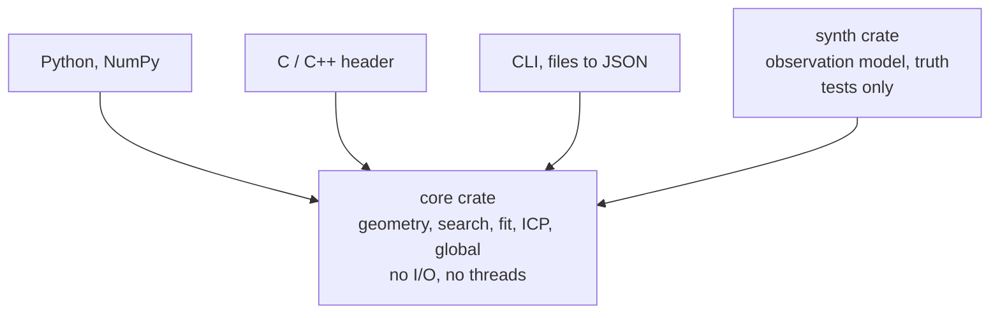

# Layers

**[sketch]** One core, thin skins. Nothing above the core holds an
algorithm.

The skins only convert, validate and call.

## Rules

- **[sketch]** The core reads no file and prints nothing: a robot has no
  terminal, a headset no file system to spare.
- **[sketch]** A skin never re-implements a default: defaults live in the
  core and are read from it.
- **[sketch]** The synthetic generator is a crate of its own: the benchmark,
  the tests and the paper's figures share one source of truth.
- **[question]** File formats (PLY, XYZ) in the CLI only, or a small I/O
  crate the Python skin may also use?
