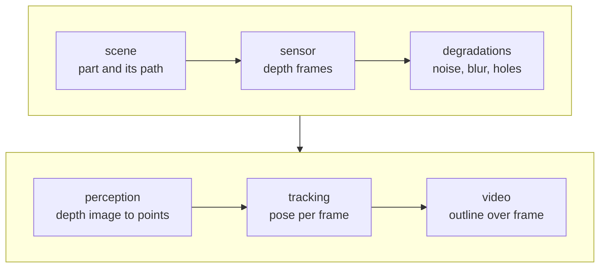

# The demos of milestone 1

**[defined]** Two demos, the simpler first, each an animation in the README
computed from real runs ([milestones](../milestones.md)).

## A — point clouds over time

Generated [sequences](../problem/sequences.md), point clouds only:

- a model moving in the sensor's space, noisy;
- partly hidden by itself and by a ball crossing in front;
- sometimes distorted, sometimes knocked;
- the two [phases](../method/tracking.md) at work: follow when the motion
  is smooth, find again after a jump.

## B — a simulated depth camera

A machined part on a turntable under a depth camera, the frames degraded
like a real sensor's. Each stage is its own algorithm, so the video also
shows which stage breaks first.

| Stage | Idea |
| --- | --- |
| A part and its trajectory, the ground truth | [scene](scene.md) |
| A pinhole depth camera, by rasterising the mesh | [sensor](sensor.md) |
| What real sensors do to depth | [degradations](degradations.md) |
| From depth pixels to a point cloud | [perception](perception.md) |
| From one pose to the next | [tracking](tracking.md) |
| What the video shows | [video](video.md) |

**[defined]** No biological model: the object is a machined part.
