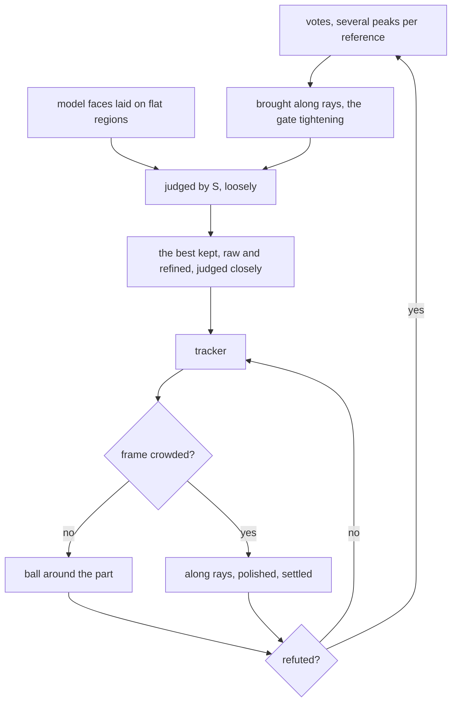

# What a pose is worth: the information of its support

**[sketch]** An answer to one question of [evidence along
rays](ray-evidence.md): is "no flat face flush with a wall" a sensor fact or a
physical prior? Here, a sensor fact, as long as the hits are counted for what
they say.

## The author's sentence

Inside the zone the rays leave free, take the place with the most model on its
border, "that is, with information". Measured with `congru-demo rank`, the two
halves are not equal. The count alone fails: the part flipped, its plate flush
on the turntable, has more hits than the truth.

**A hit counts for what it says about the pose.** A flat face, however large,
says nothing of sliding along itself.

## The score

The hits of [the visibility problem](../problem/visibility.md) with their area
$a(u) = (m_T(u)/f)^2$, $f$ the focal length, and $J_u$ the [point-to-plane] row
of the rendered surface at pixel $u$, rotations scaled by the spread of the hits:

$$
H(T) = \sum_{u \in \text{hit}} a(u)\, J_u J_u^\top,
\qquad
S(T) = \Big(\prod_{k=1}^{6} \lambda_k(H)\Big)^{1/6}
       - \sum_{u \in \text{through}} a(u)
$$

The geometric mean of the eigenvalues is the [D-optimal] criterion of experiment
design, and $H$ the matrix [observability](observability.md) already reads.

Three things the measures forced:

- **A hit needs the surface's direction too.** A thin side of the part, across
  the turntable, lies within the tolerance of its depth and looks like
  information about sliding. A hit counts only if the image's normal, a plane
  fitted over 7 × 7 pixels, agrees with the model's within 45°.
- **A ray through needs a neighbourhood.** A sensor mixes both sides of an edge:
  on the rim of the true silhouette the image seems to see through the model. A
  pixel refutes only if all returns two pixels around it lie behind the model.
- **The tolerance is half the finder's step**, 6 mm for a noise of about 5 mm.

## Measured

**[sketch]** Demo B, one sensor seed. Frames where the truth outscores every wrong
pose (more than 5° or 2 cm off), among the votes refined along rays and 100 random
poses. The 64 best of these are then improved by a local search on the score
itself. The frames were fixed in advance: 12 to choose on, 18 kept apart.

| Score | Room | In a room | Sensor |
| --- | --- | --- | --- |
| Agreement × share in frame | 9 / 10 | 7 / 10 | 10 / 10 |
| $S$ at the finder's step | 10 / 10 | 7 / 10 | 10 / 10 |
| $S$ at half of it | 10 / 10 | 9 / 10 | 10 / 10 |

Kept apart only, $S$ at half: 6 / 6, 5 / 6, 6 / 6.

**[caution]** The same run without the normals, a stronger adversary (every start
improved), interrupted: 6 / 8 and 7 / 10 in the room conditions; agreement 1 / 9
and 3 / 10. So the numbers of the table depend on the adversary; the order did
not change. Choosing among three variants on these frames is itself a little
tuning.

[D-optimal]: https://en.wikipedia.org/wiki/Optimal_experimental_design
[point-to-plane]: https://en.wikipedia.org/wiki/Iterative_closest_point

## What it changed, end to end

**[caution]** This table is [the shape crop step](../../docs/hot/shape-crop-step.md).

- **The scan was cut with the model's silhouette** at the predicted pose: a
  hypothesis choosing the data that confirm it. No sensor gives such a cut.
- **No truth reached it**, but the author called it what it is, and it is gone.
- **The current measures**: [what answers](../../docs/hot/answer-step.md), after
  [holding on](../../docs/hot/hold-step.md) and [a noisy box](../../docs/hot/box-step.md).

Demo B, the whole pipeline, frames within 2°, out of 90. The two other paths were
never used to choose anything.

| Condition | 0.75 turns, chosen on | 0.55 turns, apart | 1.3 turns, apart |
| --- | --- | --- | --- |
| Room | 0 → **90** | 0 → **76** | 0 → **86** |
| In a room | 0 → **76** | 0 → **74** | 0 → **45** |
| All effects | 84 → 83 | 89 → 86 | 76 → 74 |
| Sensor | 90 → 90 | 90 → 90 | 87 → 87 |
| Shake | 90 → 90 | 90 → 90 | 88 → 88 |
| Lens | 90 → 90 | 90 → 90 | 87 → 87 |
| Flex | 90 → 90 | 90 → 90 | 87 → 87 |

Demo A does not use this code: its table is the same to the digit. One sensor
seed per frame; the frames of each path are not independent.

## The pipeline that gave it

What each part answers, and what forced it:

| Part | Measured reason |
| --- | --- |
| Gate tightening, as in [the ladder](../problem/cloud-ladder.md) | The right vote goes from unranked to rank 0 on a failing frame |
| Faces laid on regions | Votes propose nothing on a flat face: all its pairs look alike |
| Raw and refined both kept | Rays let a right pose slide along a flat face: 112° off from rank 0 |
| Tight crop only when crowded | It cuts the edges that correct a slide, so a clean frame lost 9 frames |
| Crowded read from the count of returns | Read around the prediction, a wrong pose looks crowded, and hides that it is wrong |
| A refuted pose is not believed | The health test trusted 100° off; the same run went from 42 to 76 frames |

## [caution] What is still wrong

- **Crowded came from these frames**: 3 times the part's pixels, in a wide gap,
  under 1.7 against over 6. Refuted now stands at zero: the rays through outweigh
  what the model explains. It costs all effects some frames.
- **Detection in a room is still weak**: on the flat view, the right pose is not
  offered, or ranks past 3000 of 11000. The tracker hides this: it needs a
  detection only at the start and when lost.
- **The realistic scenes run this pipeline now**: [the step](../../docs/hot/answer-step.md).
- **Cost**: a detection in a room takes about 6 s on 4 threads, far from real time.
- **The score is coarse**: it tells a right pose from a wrong one, not 0.5° from
  2°. Choosing the higher score between two near poses made tracking worse.
