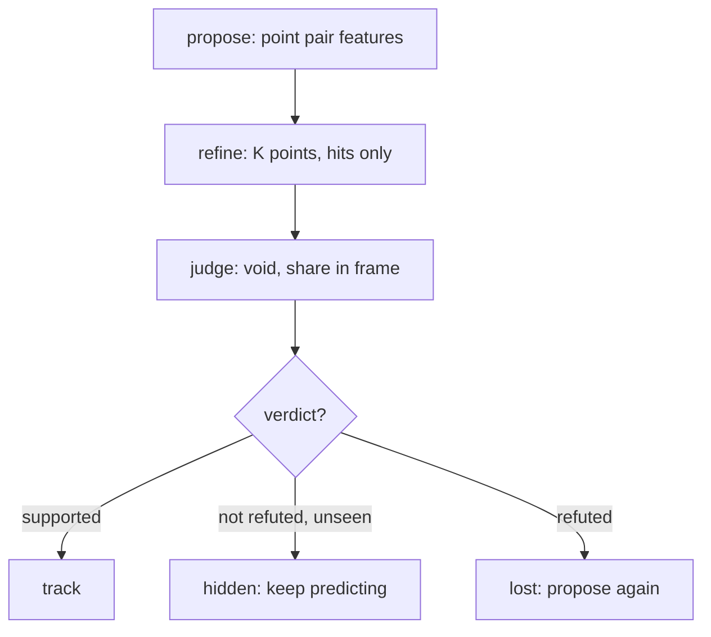
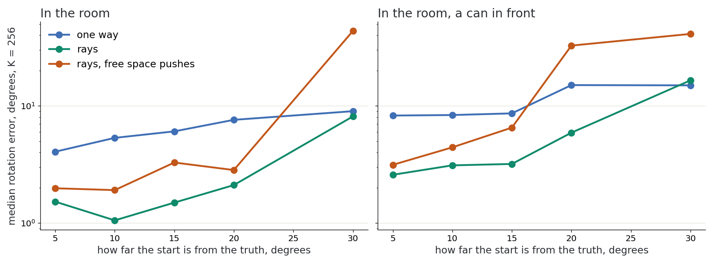

# Evidence along rays

**[sketch]** What [the visibility problem](../problem/visibility.md) changes in
the method. A ray has three jobs, and they are not interchangeable: hits move the
pose, the void judges it, the shadow costs nothing.

**[guess]** The verdict has three answers, not two. Simplified: the diagram
leaves out how hidden turns into lost after a while.

## What fails today

**[defined]** Measured on demo B's room, against the generator's truth. A truthful
box was simulated for the trace of the chain, then removed:

| Link | With a box from the truth | Without a box |
| --- | --- | --- |
| Proposal | right pose at rank 182 or 287 of about 490 on two frames of three | not traced |
| Detection | 1.4° and 2 mm, first frame | none, then 160° and 27 cm |
| Tracker, first update | 19.5°, still trusted | starts from a wrong pose |

1. **Votes do not rank poses**: planes take 189 to 299 votes where the right pose
   takes 25 to 34, so keeping the 48 best dropped it. All votes are now judged.
2. **The tracker undoes a right start**: scan-to-model pairs follow the turntable.
   Its health test keeps trusting it, up to 174° off.
3. **Without a box the clutter still wins**: why is not measured.

## Measured: refining

**[sketch]** From [the Python experiment](../experiments/visibility/measure.py),
on a copy of demo B's room, its noise and holes: `just visibility-measure`. Median
rotation error at K points, starting 5° to 15° from the truth, no can in front.

| K | One way, scan to model | Along rays, hits only |
| --- | --- | --- |
| 32 | 8° | 3° to 4° |
| 64 | 7° to 8° | 2° |
| 128 | 4° to 7° | 1.2° to 1.4° |
| 512 | 2° to 7° | 1.1° to 1.4° |

- **Why rays win**: a model point only reads its own pixel, so the turntable and
  the wall around the part cannot pull it.
- **The void must not push**: without a can it does worse as a force at every
  budget, and diverges from 30°. It judges, it does not move.
- **Every pixel**: 0.4° from 15°, so K points still pay a price.

**[caution]** The one-way comparator is a bare prototype, simpler than the Rust
tracker: no motion prior, no learned noise. It measures the principle, not it.
Four frames and sixteen starts per cell.

## Measured: judging

**[sketch]** Fresh seeds, chosen after the idea came from an earlier set. Twelve
frames, half with a can. The right pose is offered among sixty wrong ones, all
refined by the one-way method; how often is it chosen? K sets the share's draw.

| K | Offered | One-way inliers | Agreement today | Agreement × share in frame |
| --- | --- | --- | --- | --- |
| 64 | exact | 0 / 12 | 1 / 12 | 10 / 12 |
| 64 | 6° off | 0 / 12 | 0 / 12 | 5 / 12 |
| 128 | exact | 0 / 12 | 3 / 12 | 11 / 12 |
| 128 | 6° off | 0 / 12 | 1 / 12 | 4 / 12 |
| 512 | exact | 0 / 12 | 5 / 12 | 9 / 12 |
| 512 | 6° off | 0 / 12 | 2 / 12 | 6 / 12 |

- **The share in frame is the largest gain measured here**, and it costs K
  projections.
- **Judge after refining**: the score falls quickly with the angle, while a voted
  candidate is only known to a bin of 12°. **[guess]** The real detector judges
  raw votes.
- **K points alone do not choose**: at most 1 / 12. The agreement above still renders
  every pixel. A flat face against a wall has many hits and no void.

Trusting a pose over the same frames, one-way health test against the void and the
share in frame. At K = 128:

| Poses | Health test trusts | Rays trust |
| --- | --- | --- |
| True, alone | 100 % | 100 % |
| True, can in front | 100 % | 100 % |
| 3° off | 100 % | 100 % |
| Wrong | 75 % | 28 % |

- **A hidden part stays trusted**: with the can, the shadow goes from 35 % to
  56 % of the points while the void stays at 6 %. That is the hidden state,
  measured.
- **28 % of wrong poses remain**: this filters, it does not settle.

## Measured: the real detector

**[sketch]** Demo B, one sensor seed, the scene that served the diagnosis: no held-out
data, so a gain may not carry over. Frames within 2°, out of 90. Each row adds to
the one above, except the last, which removes the box.

| Detector | All effects | Shake | Room |
| --- | --- | --- | --- |
| 0.1.18 | 79 | 87 | 0 |
| Refined along rays, nearest in 7 × 7 pixels, box | 79 | 90 | 0 |
| All votes judged, box | 84 | 90 | 0 |
| All votes judged, no box (kept) | 84 | 90 | 0 |

- **The refiner holds from near**: from 13° off, 1° to 5° around two axes; around
  the third, 8° to 12° on three frames of four.
- **Kept without the box**: it came from the truth, and gave no gain in this table.
- **Cost**: every vote is refined and rendered. Demo B took 1 min 42 s with 48
  candidates in a box, 2 min 29 s with all votes and no box; one detection was not
  timed.

## Open

- **[question]** Tracker along rays, with three verdicts: the link that breaks first
  once detection is right ([open](../open.md)). **[sketch]** A first answer, without
  moving the tracker: [end to end](pose-information.md#what-it-changed-end-to-end).
- **[question]** How to detect in clutter without a box. **[sketch]** Partly answered
  there too; the flat view is not.
- **[question]** Is "no flat face flush with a wall" a sensor fact, by the
  contour, or a physical prior? Sampling the contour with K points did not work
  yet. **[sketch]** A sensor fact, by [the information of the
  hits](pose-information.md).
- With a can in front, K points stay near 3° where every pixel gives 0.7°.
- The proposal is measured now: on demo B's room, 0 to 6 of about 1500 single-peak
  votes lie within 15° and 3 cm of the truth; one peak per reference is too few.
