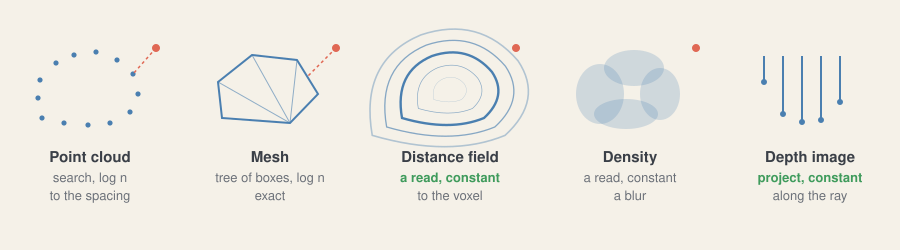

# How a shape is held

**[sketch]** A model is rarely a cloud: it is a mesh. And what an alignment asks
of a shape is always the same: **how far is this point, and in which direction?**
Each way of holding a shape answers at a different price.

| Held as | Distance costs | Exact? | Good for | Bad for |
| --- | --- | --- | --- | --- |
| [Point cloud](https://en.wikipedia.org/wiki/Point_cloud) | Search, log n | To the spacing | What a sensor gives | Nothing between the points |
| [Mesh](https://en.wikipedia.org/wiki/Polygon_mesh) | [Tree of boxes](https://en.wikipedia.org/wiki/Bounding_volume_hierarchy), log n | Yes | The model of a part | A costly query |
| [Signed distance field](https://en.wikipedia.org/wiki/Signed_distance_function) | Read, constant | To the voxel | Speed, GPU, a sign | Memory, building it |
| [Density](https://en.wikipedia.org/wiki/Normal_distributions_transform) | Read, constant | A blur | Smooth basins | Thin details |
| Analytic | A formula | Yes | Boxes, cylinders, a plane | Any real part |
| Depth image | Project, constant | Along the ray | The frame itself | One view only |

## The two sides

An alignment pairs a **model** with an **observation**. Done and not:

| Model ↓ / Frame → | Points | Depth image | Mesh of the depth |
| --- | --- | --- | --- |
| Points | [ICP](https://en.wikipedia.org/wiki/Iterative_closest_point) | Along rays | To do |
| Mesh | **Done**, exact | Rendered, rays | To do |
| Distance field | **Done**, a read | To do | To do |
| Density | To do | To do | To do |

## Why the field comes first

**[sketch]** Measured, [one thread](../../docs/benchmark/on-mesh.md), on one
bracket, against [others](../../docs/benchmark/comparison.md):

| Held as | Error | Time |
| --- | ---: | ---: |
| Samples, 3 mm | 0.098 mm | 17.9 ms |
| The mesh, exact | 0.094 mm | 43.6 ms |
| A field, 2 mm | 0.083 mm | 5.9 ms |

- **Speed**: a read and a trilinear blend instead of a search. Exact costs most.
- **[guess]** **GPU**: a 3D texture is what a GPU reads best.
- **[guess]** **The proof**: on the surface itself, to the grid's error, not on
  samples.

**[caution]** Its limits: memory grows with the cube of the resolution, it must
be built once per model, and a thin part needs a fine grid. A narrow band, as in
[VDB](https://en.wikipedia.org/wiki/OpenVDB), keeps what is near the surface.
