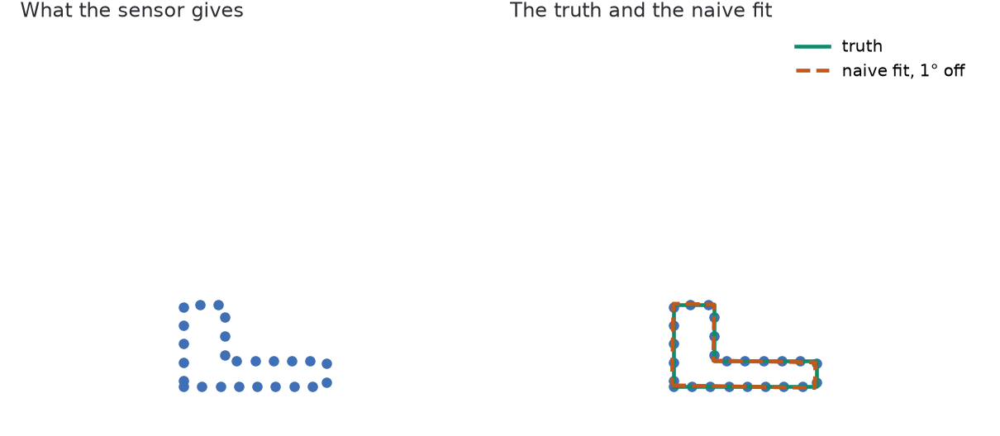
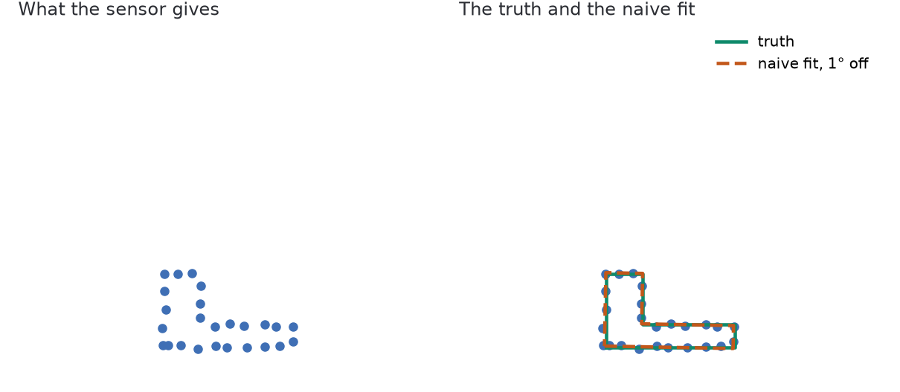
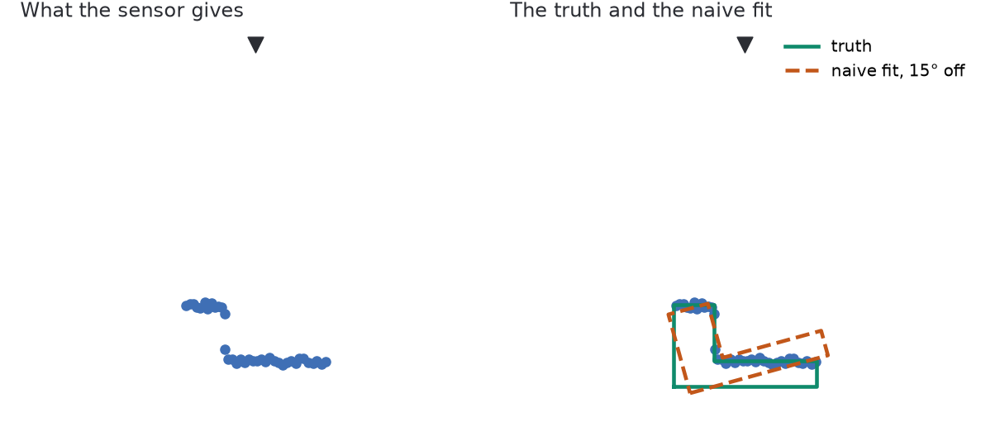
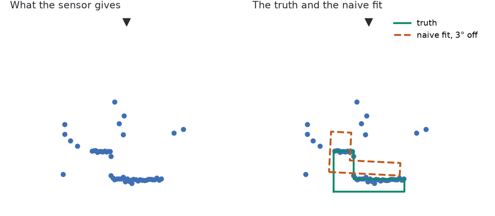
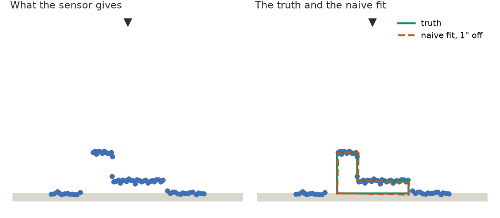
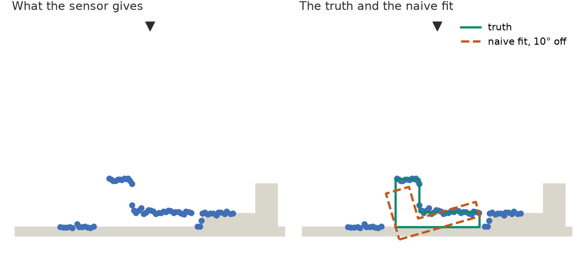
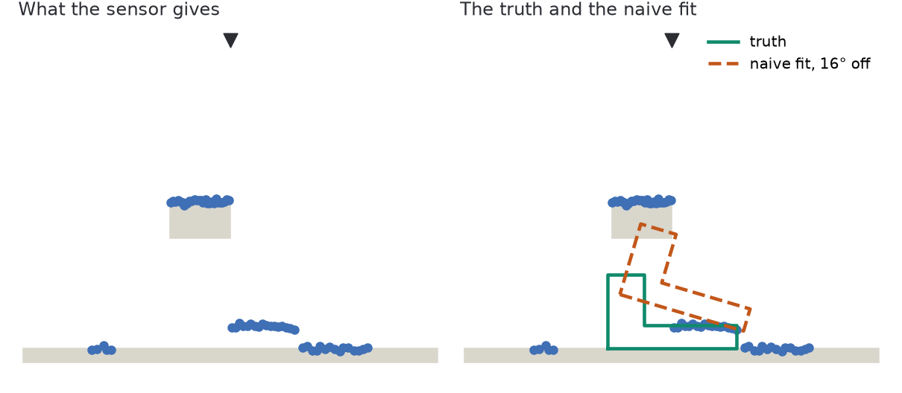
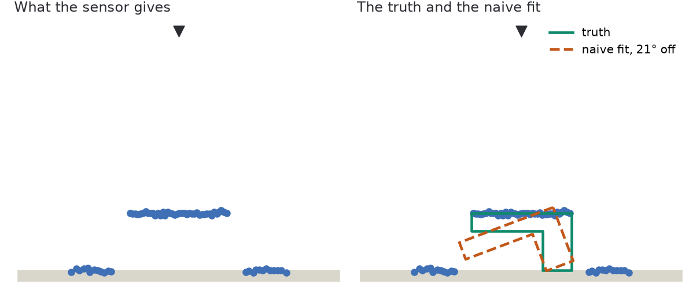

# A ladder of clouds

**[sketch]** A first draft of a series of harder and harder clouds, to be redrawn
by the author. Each step adds hidden or extra information, and asks what the
algorithm must change. A person sees the answer in the left panel of every figure.

| Axis | What grows | Steps |
| --- | --- | --- |
| Hidden information | The model is less and less seen | 3, 7, 8 |
| Extra information | The frame holds more than the model | 4, 5, 6, 7 |

**How it is measured**: 2D, 64 rays from a camera, 4 mm of noise, one seed, 8
starts 15° to 30° from the truth. The naive fit is bare [ICP], scan to model. All
of it is a toy: `just ladder`.

## The steps

### 1. Seen all round

- **Measured**: 1.0° and 1 mm.
- **Teaches**: with the whole shape, nearest points suffice from a rough start.

### 2. Noise

- **Measured**: 1.0° and 3 mm: noise alone changes little.
- **Teaches**: averaging absorbs it. It is not the hard part.

### 3. One side only

- **Measured**: 15° and 22 mm, and 26 rays pass through the model at that pose.
- **Reversed**, model to scan: 0.5° but 38 mm, the unseen side drags it.
- **Teaches**: unseen must cost nothing; a ray that crossed the model is evidence.

### 4. Stray points

- **Measured**: 2.9° and 71 mm, with 39 rays through the model.
- **Teaches**: a few points far from the shape need a [robust loss]. Rays refute
  it.

### 5. A table under it

- **Measured**: 0.8° and 3 mm. **The step does not bite here.**
- **[caution]** Demo B's turntable does pull the real tracker, so this toy misses
  something. The author's own step should replace it.

### 6. A near twin beside it

- **Measured**: 10° and 7 mm.
- **Teaches, [guess]**: a start decides which object is fitted. Should the answer
  be two poses?

### 7. A can in front

- **Measured**: 16.5° and 85 mm. At the truth, 20 rays are hidden and none through.
- **Teaches**: in front is not behind. Hidden costs little, through costs a lot.

### 8. Its flat side up

- **Measured**: 20.6° and 33 mm.
- **Teaches, [guess]**: the edges of the seen surface hold the pose, more than the
  surface. The grid below agrees: rays still isolate the truth here.

## What the ladder asks of the algorithm

| Requirement | From step | In Congru today |
| --- | --- | --- |
| Unseen costs nothing | 3 | Partly: only the visible model is aligned |
| A ray through the model refutes it | 3, 4, 7 | Detection only |
| Hidden differs from refuted | 7 | Counted as a miss |
| Several poses can be the answer | 6, **[guess]** | One pose |

## Is the information there?

**[sketch]** The author's argument: a person aligns these in a 3D editor, so the
frame holds the answer. Test: score a grid of poses by rays only, hits minus three
times the rays through, the truth off the grid.

- **Cells**: every 5° over the full turn, 15 mm over 6 cm around the truth.
- **So the best possible** is the nearest cell: 2.5° and 11 mm.

| Step | Best pose by rays | Poses within 10 % of the best |
| --- | --- | --- |
| 3 One side | 2.5°, 11 mm | 2 of 5832 |
| 4 Strays | 2.5°, 11 mm | 1 of 5832 |
| 5 Table | 2.5°, 11 mm | 3 of 5832 |
| 6 Twin | 2.5°, 11 mm | 4 of 5832 |
| 7 Can | 7.5°, 11 mm | 4 of 5832 |
| 8 Flat side | 2.5°, 11 mm | 4 of 5832 |

**Supported on this toy**: rays alone isolate the truth at every step, one cell
further with the can, while the naive fit misses it. `just ladder-survey`.

- **Not a method**: a grid is not real time, and nothing here is in 3D.
- **The window flatters it**: it stays near the truth, so far poses, such as the
  twin's, are not scored.

**[caution]** A person is not proof for every frame:

- **A person moves the view**, and knows what objects are; a frame gives less.
- **A person's precision was not measured**, and it may be far from 1°.

## Open

- **[question]** The author's own series: which clouds, drawn by hand?
- **[question]** Does a step exist where the person also fails? That would mark
  the limit of the information.

[ICP]: https://en.wikipedia.org/wiki/Iterative_closest_point
[robust loss]: https://en.wikipedia.org/wiki/Robust_regression
