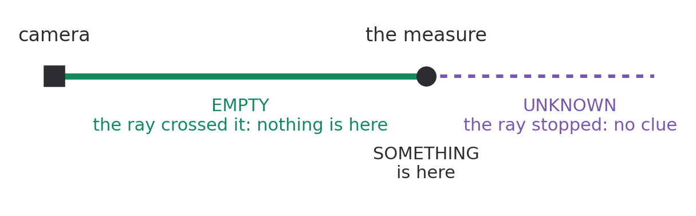
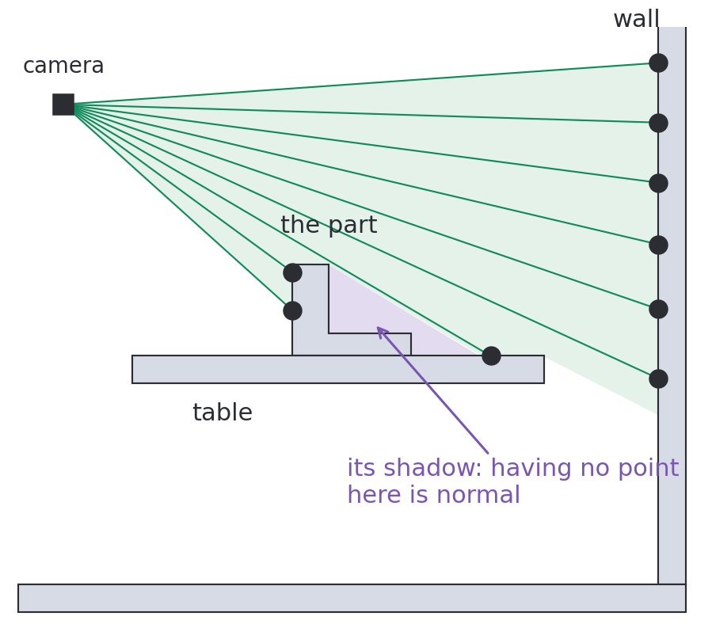
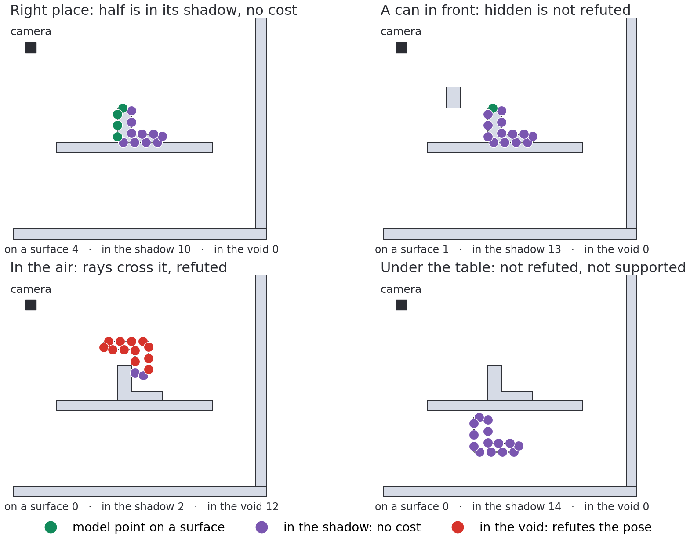
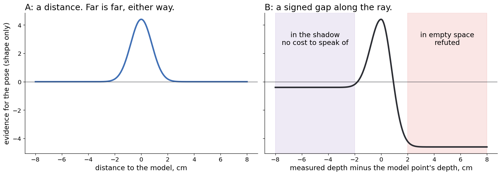

# What a depth frame says

**[defined]** Problem A aligns points. Problem B reads rays: a pixel states
where a surface is, that space before it is empty, and nothing about space
behind it. Behind a point seen from the camera, having no point is normal.

The experiments that answer this page:

- [the ladder](cloud-ladder.md), in 2D;
- [evidence along rays](../method/ray-evidence.md);
- [what a pose is worth](../method/pose-information.md);
- [the cases, frame by frame](../../docs/projection-cases.md);
- demo B [cut to the model's shape](../../docs/shape-crop-step.md), then
  [with a noisy box](../../docs/box-step.md).





## Why a person succeeds where the method fails

**[defined]** In demo B's room the data is not what is missing: the part is
plain in the depth. A person in a 3D editor, given this cloud, would place the
model by reasoning on constraints, despite the missing side.

| What the person reasons | The constraint | In the method today |
| --- | --- | --- |
| "Nothing behind it, of course" | Unknown space costs nothing | Partly: only the visible model is aligned |
| "It cannot be there, I see through it" | A ray forbids what it crossed | Only when detecting |
| "That can hides a part of it" | Hidden differs from refuted | Counted as a miss |
| "This corner is that corner" | Structure proposes a pose | Point pair features, votes on the whole frame |
| "It does not float, nor sink" | Physical support | **[question]** a prior the sensor does not give |

## The formal problem

**[sketch]** The frame is a depth per pixel, $d(u)$, or nothing. A pose $T$ of
the model gives by rendering the depth the model would have, $m_T(u)$, on its
silhouette $\Omega_T$. Everything turns on one signed number, along each ray:

$$\delta_T(u) = d(u) - m_T(u)$$

| $\delta_T(u)$ | The sensor sees | Verdict | What it says of $T$ |
| --- | --- | --- | --- |
| $\approx 0$ | At the model's depth | **Hit** | Supports it |
| $\ll 0$ | In front of the model | **Hidden** | Nothing: something may hide it |
| $\gg 0$ | Beyond the model | **Through** | Refutes it: the ray crossed the model |
| No return | A hole | **Silent** | Nothing, on a sensor whose holes are random |

## With a budget of K points

**[defined]** A real-time method has a budget of K points per frame: a draw, not
every pixel. So the verdict is read from model points, with no rendering.

1. Draw K points of the model and place them at $T$.
2. Project each one on its pixel $u$ and read $d(u)$.
3. Compare its depth with $d(u)$: on the surface, in the shadow, or in empty space.

- **The cost is $O(K)$ per pose**: a projection and one pixel read per point.
- **A point on the far side falls in the shadow by itself**, and costs nothing.
- **Any point can refute**, on the far side too: empty space is empty.



## The two questions, kept apart

- **Feasible**: few rays go through the model. The poses the frame leaves possible
  are $\mathcal{F} = \{T : |\text{through}_T| \le \varepsilon |\Omega_T|\}$.
- **Supported**: many rays hit it. Bottom right of the figure, a part under the
  table is feasible and has no support at all.

A person asks both. A one-way residual, from the scan to the model, asks neither:
it only asks whether the points kept lie near some surface of the model.

## Why this is a likelihood, not a heuristic

**[sketch]** The unknown is $T$ and the rest of the world $W$, which may stand
before the part or behind it, but not where rays passed. For each pixel, compare
the frame with the object at $T$ against the frame with $W$ alone:

```math
\ell_T(u) = \log \frac{p(d(u) \mid T, W)}{p(d(u) \mid W)}
= \log\!\left(
  w_h \frac{\mathcal{N}(\delta_T(u); 0, \sigma^2)}{p_W(d(u))}
  + w_o [\delta_T(u) < 0] + w_t
\right)
```

- A pixel outside $\Omega_T$ gives $\ell = 0$: the object predicts nothing there,
  so the clutter of a whole room cancels out and needs no outlier model.
- Hidden costs $\log w_o$ and through $\log w_t$, with $w_t \ll w_o$. The two sides
  of the kernel differ, which an unsigned distance cannot express.
- Finding the object is then $\arg\max_T \sum_{u \in \Omega_T} \ell_T(u)$.
- It is a sum, not a share: a share lets a pose mostly out of the image win on
  one small patch that fits ([measured](../method/ray-evidence.md)).



**[to check]** Three neighbours, to read again before citing:

- the [beam model] of range sensors, here applied to an object;
- [Wüthrich et al.], who model occlusion in a depth likelihood;
- [Ganapathi et al.], who add free space to ICP.

## Should uncertainty be in the algorithm?

**[sketch]** Yes, as a set rather than a number.

- **The answer is $\mathcal{F}$ with its support.** One mode: a pose. Two modes:
  say so. This is [observability](../method/observability.md), from local to global.
- **Hidden is a state of the object.** "Hidden by something" and "not there" are
  different answers, and the tracker can only give one of them today.
- **Frames accumulate.** Each one carves more empty space, as in [volumetric
  fusion]; a side unseen now is constrained by the frame that saw it.

[beam model]: https://calvinfeng.gitbook.io/probabilistic-robotics/basics/robot-perception/01-beam-models-of-range-finders

[Wüthrich et al.]: https://arxiv.org/abs/1505.00241

[Ganapathi et al.]: https://doi.org/10.1007/978-3-642-33783-3_53

[volumetric fusion]: https://graphics.stanford.edu/papers/volrange/
